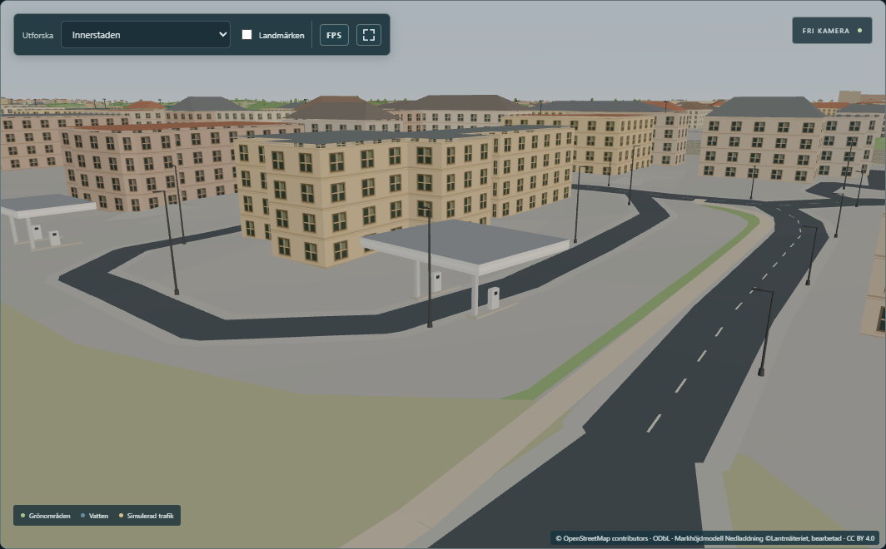
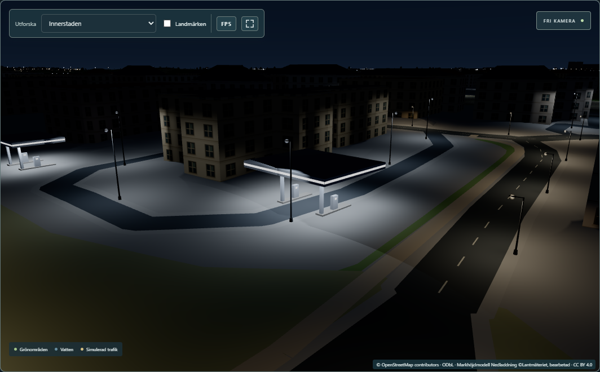
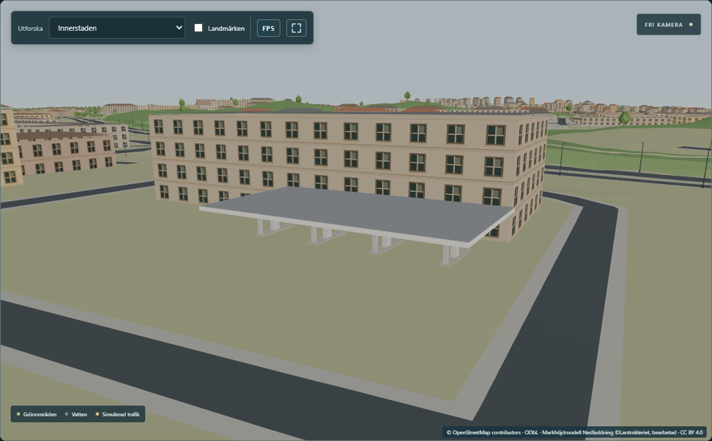
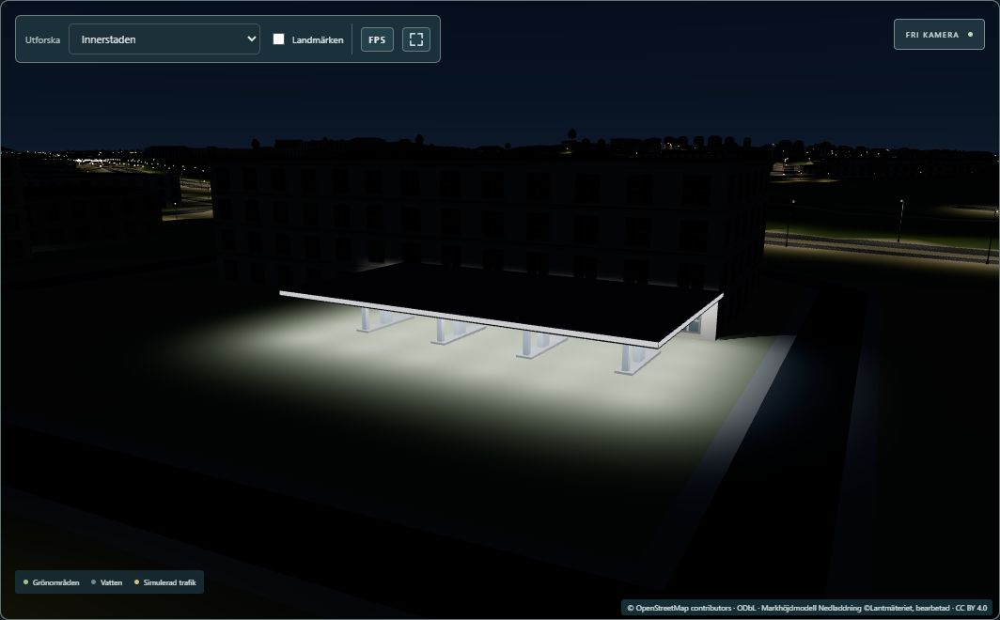
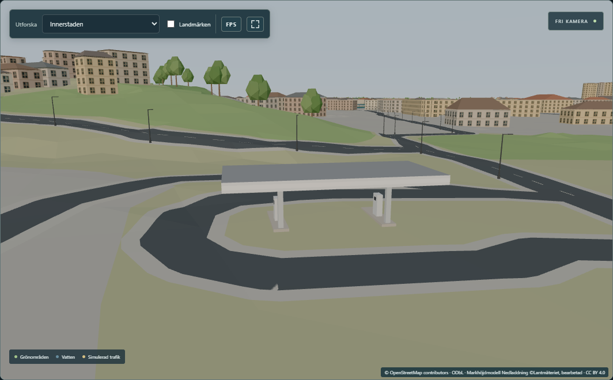
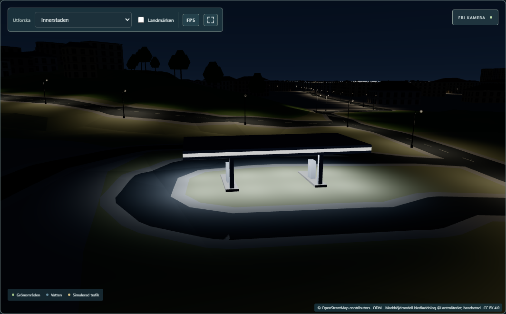
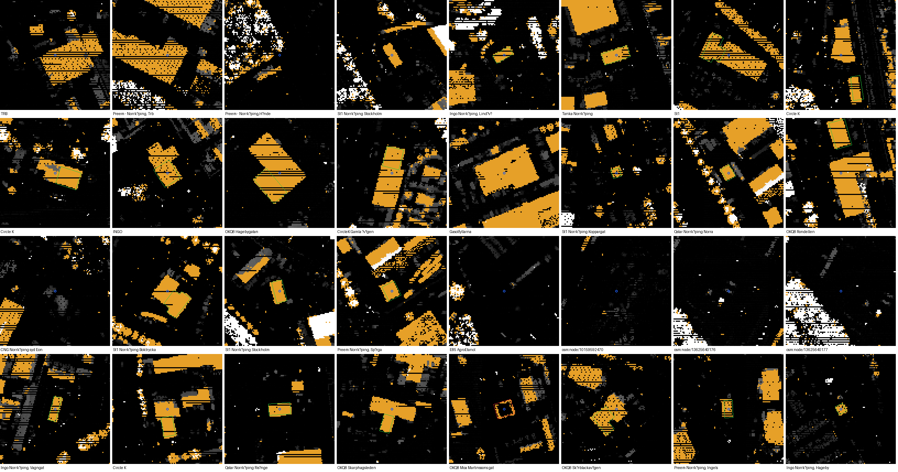
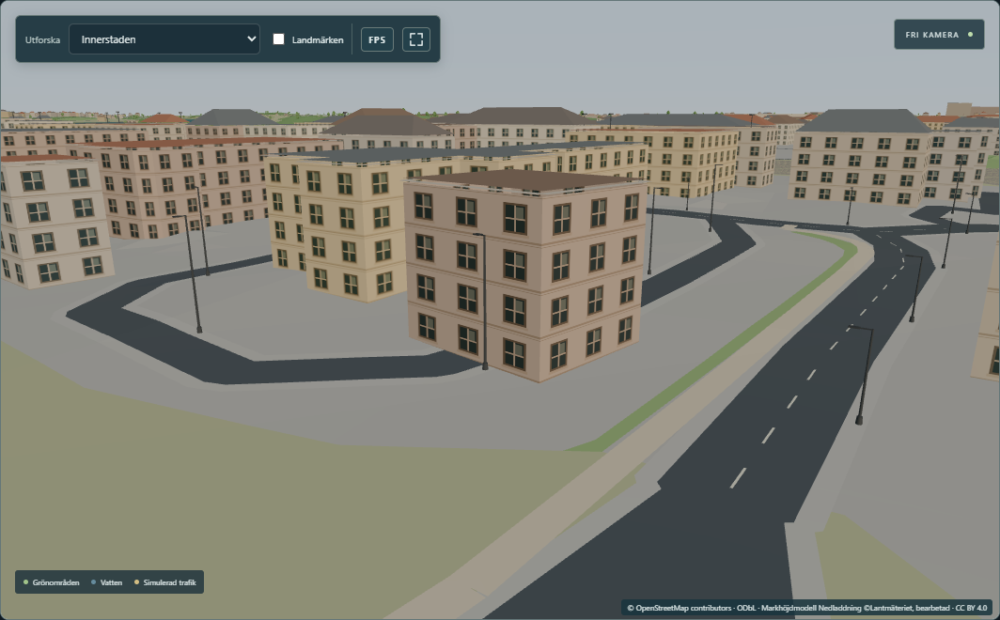
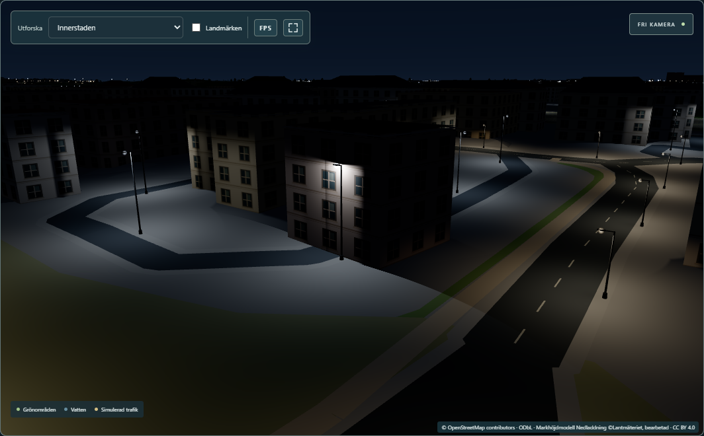

# Phase D2 — fuel stations: measured canopies, estimated pumps and canopy lighting (2026-11-10)

Worked directly on local `main` (= `origin/main` `7447e9f`). Backend unchanged. **Approved by the
user on 2026-11-10 with the recommended decisions below; committed (`dbb1289`) and pushed to
`origin/main`.** Roadmap track D, step D2.

## Verdict

21 of Norrköping's 32 mapped fuel stations now have a canopy over the pumps, at the height measured
in Lantmäteriet's laser data (4.0–6.0 m to the top). Each canopy has estimated pump islands,
dispensers and columns, a neutral lit sign band and recessed downlights. At night the forecourts are
bright (≈ 70–180 lux, a typical lit street gets 10–20). Before, the city drew these canopies as solid
13 m blocks with hipped roofs. Recommendation: **approve**. The geometry is measured where it can be,
everything else is labelled as an estimate, and the cost is not measurable (see *Measured*).

After the first review the user decided (2026-11-10) to build two more stations from the laser
data. Their canopies are interpretations, labelled as such:
- **OKQ8 Hagebygatan:** the outline is measured from the laser data. OSM has none.
- **Ingo Lindövägen:** an OSM `building=yes` outline is read as the canopy.

The 11 stations still without a confirmed canopy are deliberately left out.

## Decisions (the user chose the recommendations, 2026-11-10)

1. **The remaining 11 stations without a canopy: build nothing.** *Recommended.* Their laser data
   shows no canopy near the station, or only a small patch (truck stops, gas and ethanol pumps, three
   unnamed points).
2. **Station buildings stay 13 m tall.** The kiosks next to the canopies keep the city's default
   height for buildings without a height tag, and look too tall. At Hagebygatan the building next to
   the new canopy is 4.9 m in the laser data but drawn at 13 m. *Recommended:* measure the heights from
   the laser data in a separate follow-up, since that changes the generic buildings, not D2.
3. **No price pylons.** Their positions are not mapped. *Recommended:* leave them out.
4. **Lights on all night with the street lighting, 4 000 K.** *Recommended:* keep. Real schedules are
   unknown, and 4 000 K matches the site lighting of parking lots (L2d).

## Risks / not verified

- Everything below the canopy roof is an **estimate**: the islands, dispensers, columns, lights and
  sign band. Laser data seen from the air cannot see under a roof, and no plan or photograph was used.
- **The two added canopies are interpretations.**
  - *Hagebygatan:* the flat roof at 4.0 m beside the station could also be another low roof, such
    as a car wash or a carport.
  - *Lindövägen:* OSM calls the outline only "building". It is flat at 4.3 m with no ground return
    below it, inside the forecourt loop, and INGO stations are unmanned, so a canopy is the likely
    reading.
- **Both added canopies are low** (4.0 and 4.3 m to the top). Their edge band is therefore estimated
  shallower: 0.47 and 0.77 m instead of 0.9 m, so the underside stays 3.5 m above the ground. Every
  other canopy keeps 0.9 m.
- The laser data is from 2020. A canopy built or removed after 2020 is missed, which is probably the
  case at OKQ8 Moa Martinssons gata.
- No canopy was compared with a photograph.
- Timing is from one machine (RTX 5070 Ti). See *Measured*.




The two added stations:

| | Day | Night |
|---|---|---|
| OKQ8 Hagebygatan (outline from the laser data) |  |  |
| Ingo Lindövägen (OSM building read as the canopy) |  |  |

More (final code, all 13 views): [evidence/v2/](evidence/v2/), for example
[Rondellen by day](evidence/v2/02-day-rondellen.png) / [at night](evidence/v2/06-night-rondellen.png),
[St1 Boktryckargatan close-up at night](evidence/v2/07-night-boktryckargatan-close.png),
[OKQ8 Skärblackavägen at night](evidence/v2/08-night-skarblacka.png),
[St1 Hagagatan from the street at night](evidence/v2/09-night-hagagatan-street.png). The first
version's screenshots (19 stations) are kept in [evidence/](evidence/).

## What was built

| Part | Kind | Where it comes from |
|---|---|---|
| Canopy outline (21) | source / measured | OSM `building=roof` (18) and `building:part=roof` (1) next to the station. User decision 2026-11-10: one OSM `building=yes` read as the canopy (Ingo Lindövägen) and one rectangle measured from the laser data (OKQ8 Hagebygatan, 28.6 × 15.6 m; the roofed cells fill 85 % of it) |
| Canopy top height | measured | LiDAR 2020: median of the roofed 1 m cells, 3.97–5.97 m above the surrounding ground; flat within 0.13 m (median p90 − p10) |
| Edge band (fascia) | estimate | 0.9 m, but never so deep that the underside comes within 3.5 m of the ground. Only the two low canopies are affected (0.47 and 0.77 m) |
| Pump islands (48), dispensers, columns | estimate | one island per 7.5 m of canopy length, across the canopy; one dispenser and one column each |
| Downlights (239) | estimate | 5 m grid, 1 200 cd, 4 000 K; 73–180 lux on the ground under the lamps (median 106) |
| Sign band, dispenser displays | estimate | neutral white, lit at night. No logos, because the operators' logos are not licensed |

The laser-data check, per station (orange = 3.5–8.5 m above ground; green outline accepted, red
not; the blue ring is the OSM station point). Final version:



(The first version's sheet, before the two added stations, is
[lidar-canopies.png](evidence/lidar-canopies.png).)

**Not built (11):**
- three unnamed points and a gas depot;
- the CNG and E85 pumps;
- two truck/port stations at Händelö and the TRB truck stop;
- St1 Stockholmsvägen 34, which has no canopy outline in OSM and no roofed patch outside its
  building;
- OKQ8 Moa Martinssons gata, whose outline was only 24 % roofed in 2020.

Details and the laser-data candidates are in [remaining-gaps.md](remaining-gaps.md).

## How it is built

| Part | File | What |
|---|---|---|
| Measurement | [`scripts/fuel-d2/canopies_lidar.py`](../../scripts/fuel-d2/canopies_lidar.py) → [`src/lib/data/fuel-canopies.json`](../../src/lib/data/fuel-canopies.json) | Associates outlines with stations, measures top, ground, roofed share and flatness, and accepts or rejects each with a reason. It records LiDAR candidates for the rest. The two user-decided stations are in `INTERPRETED` and `LIDAR_OUTLINE`; the measured rectangle is stored as `ringSweref`. Deterministic, byte-identical rebuild |
| Values | [`src/lib/fuel/spec.ts`](../../src/lib/fuel/spec.ts) | Every estimate, tagged `[OSM]` / `[LIDAR]` / `[EST]`, and the fascia rule `fasciaDepth` |
| Layout | [`src/lib/fuel/layout.ts`](../../src/lib/fuel/layout.ts) | Pure functions: the outline (from the map, or `ringSweref` converted like the map), the canopy frame (minimum-area rectangle), islands, dispensers, columns, downlights |
| Model | [`src/lib/fuel/fuelStations.ts`](../../src/lib/fuel/fuelStations.ts) | All 21 canopies in **three merged meshes** (structure, soffits, lit parts), plain `MeshStandardMaterial`s with vertex colours (no new shader program). The night glow is the emissive intensity × the street lighting's night level, 0 by day |
| Downlights | [`src/lib/fuel/fuelLighting.ts`](../../src/lib/fuel/fuelLighting.ts) | The lamps as street-lighting fixtures, rollout `fuel-d2-v1`, IDs `estimate:fuel-d2-v1:<canopy>:s<n>` (canopy = `way/…` or `lidar:node/…`), occlusion from nearby building walls. They run in the existing shader grid: no three.js lights, no new program |
| Lighting core | [`fixtures.ts`](../../src/lib/lighting/fixtures.ts), [`registry.ts`](../../src/lib/lighting/registry.ts) | A new support kind `canopy-underside` (the lamp hangs at a given height instead of standing on the ground or a bridge) and a new fixture type `canopy-downlight` (a flush housing and lens). The existing types and their output are unchanged |
| Wiring | [`mapView.ts`](../../src/lib/mapView.ts), [`cityPlaces.ts`](../../src/lib/cityPlaces.ts), [`Scene.svelte`](../../src/lib/Scene.svelte) | The 20 OSM outlines (`FUEL_REPLACED_IDS`) join `DETAILED_BUILDING_IDS`, so their OSM blocks are no longer drawn; the OSM data itself is unchanged, and so is the building beside Hagebygatan. The downlights join every citywide set (not the A1–A3 start set). New hooks: `registries.cityNoFuel()` (main's set) and `registries.fuel()` |

## Before and after

The same viewpoints on `main` (`7447e9f`): the canopies were 13 m blocks with hipped roofs, and there
was no forecourt light.

| | Before (main) | After (D2) |
|---|---|---|
| Day |  |  |
| Night |  |  |

Nine viewpoints on `main` are in [evidence/before/](evidence/before/). They were taken before the
two stations were added, so they do not include them.

## Measured

Paired timing against `main` (`7447e9f`) on the final code (21 canopies, 239 downlights), the same
set-up as B2:
- hook builds, fullscreen 2560×1440;
- traffic on, through the backend copy 8095;
- Edge headless, uncapped, 600 frames per view;
- builds in rotated order, 5 rounds; a round starts only when background CPU is ≤ 18 % (it was
  4.2–10.6 %);
- harness: `scripts/fuel-d2/paired.mjs`, copied from B2's with D2's views.

The views are:
- *Ingelsta*: the Ingelsta focus, with Circle K Järngatan, St1 Koppargatan and Preem Ingelsta in
  view;
- *Bangården*: the rail-yard focus, with Qstar Norra and Preem Spårgatan;
- *Overview*: every station.

Each difference is to `main` in the same round, as median [min … max] in ms. *rAF* is the time
between two frames as the viewer sees it; *p95* is the time that 95 % of the frames stay under.

| View | `main` rAF mean | D2 | rAF mean | rAF p95 | Draw calls |
|---|---:|---:|---:|---:|---:|
| Ingelsta, night | 3.02 ms | 3.17 | +0.09 [−0.42 … +0.17] | +0.40 [−1.90 … +1.50] | 439 → 443 |
| Ingelsta, day | 2.66 | 2.72 | +0.07 [−0.17 … +0.15] | +0.20 [−0.60 … +0.80] | 438 → 442 |
| Bangården, night | 3.54 | 3.45 | −0.25 [−0.50 … +0.03] | −1.30 [−1.90 … −0.10] | 447 → 451 |
| Overview, night | 7.38 | 7.48 | +0.05 [+0.02 … +0.11] | +0.10 [−0.10 … +0.10] | 2 021 → 2 024 |

- **Reading:** no cost that matters.
  - In the overview, D2 was 0.05 ms slower in every round (+0.02 … +0.11), which is about 1 % of
    the frame. That fits three more meshes and a few more grid lamps.
  - The other views differ by −0.25 … +0.09 ms in the median, both up and down, which is noise. So
    are their p95 swings: one *Bangården* result is faster on D2, which the lights cannot cause.
  - No frame took over 16.7 ms in any run (the slowest single frame was 11 ms).
  - There are 3–4 extra draw calls: the three merged canopy meshes plus, near a station, the
    downlights' lens visuals.
- **The machine drifted during the run.** Both builds slowed from about 2.5 to 3.1 ms in *Ingelsta*
  between round 1 and round 5. This run also had more draw calls than the first one (439 against
  255 in *Ingelsta*), with the same 202 vehicles, so the traffic stream was in a different state.
  Pairing within each round cancels both.
- The first version (19 canopies, 207 lamps), measured earlier the same day, gave −0.05 … −0.01 ms.
- Data: [data/paired-2.json](data/paired-2.json) ([summary](data/paired-2-summary.md)); first
  version [data/paired.json](data/paired.json) ([summary](data/paired-summary.md)).

## Checks

All on the final code (21 canopies):

| Check | Result |
|---|---|
| `npm run check` (type check) | 0 errors, 0 warnings (1 223 files) |
| `npm run build` | OK. Built twice: all 29 files of `dist/` byte-identical (SHA-256); no test hook in `dist/` |
| Vitest (PowerShell, `C:\` path) | 603 / 604. The new `fuel.test.ts` passes 9 / 9. The one failure is the known `police.test.ts` (CRLF line endings of `public/assets/polis-emblem.svg` in this checkout; unrelated, untouched, as in the B2 and B1-2 reports) |
| Playwright, full suite, 29 tests including the new `fuel-stations.spec.ts` (dev server `phase0-e2e` + backend `phase0-backend`) | **29 / 29** (6.9 min) |
| LiDAR measurement rebuilt | byte-identical: data `474a001c…a1e1a9227a`, contact sheet `25857cac…6153442b` |
| Earlier phases' output | No generated data file of an earlier phase changed (`git status` lists only the files under *Files*). The new support kind and fixture type are used only by the D2 lamps; the existing fixture types' shapes and photometry are unchanged, and every earlier lighting test passes |
| Prettier | New files formatted. The changed existing files (`fixtures.ts`, `registry.ts`, `Scene.svelte`, …) were not Prettier-clean on `main` and were not reformatted |
| In the running app | Screenshots in [evidence/v2/](evidence/v2/), taken with `scripts/fuel-d2/shots.mjs`. 20 shader programs by day and at night in every shot; `describe()` lists rollout `fuel-d2-v1` with 239 estimated fixtures |

What the new tests check:
- `fuel.test.ts`:
  - all 32 stations are accounted for and 21 are built;
  - every accepted canopy is flat, roofed and 3.8–7 m high;
  - the rejected outline is not built;
  - the two decided canopies carry their labels;
  - Hagebygatan's rectangle is 300–600 m², filled to ≥ 75 % and overlaps the adjoining building by
    < 5 %;
  - exactly the 20 OSM outlines are replaced; the building beside Hagebygatan, the other roofs and
    the OSM data are untouched;
  - the frames are metric, the rectangle encloses the outline, and the fascia is 0.9 m except on
    canopies lower than 4.4 m;
  - islands, columns and lamps lie inside their outline;
  - the rendered terrain agrees with the LiDAR ground within 0.6 m, and the underside is 3.2–6.5 m
    above it everywhere;
  - three standard meshes, no glow by day;
  - the lighting set validates; each lamp hangs 5 cm below its canopy;
  - 73–180 lx under the lamps and 0 lx on the canopy's top;
  - the set is accepted with the full citywide set (≤ 32 per cell, no overflow, its own rollout, the
    site category unchanged, no three.js lights).
- `fuel-stations.spec.ts`:
  - the model is in the scene;
  - 239 downlights;
  - at night the forecourt luma (screen brightness, 0–255) is 2.7 without the downlights and 173
    with them;
  - the same picture after swapping back;
  - by day no glow and no difference;
  - 20 programs.

**Tests changed for D2:**
- `tests/lighting.spec.ts` (Phase L2a) counts the composition of the default citywide set. That set
  now contains the 239 downlights by design, so the sum gains `fuel.estimated` together with a new
  assertion that the rollout is exactly `{ mapped: 0, estimated: 239 }`. The test is stricter than
  before, not looser. L2d added its site lighting to the same line in the same way.
- `corridor.test.ts` and `streetlights.test.ts`: a type fix only (see *Files*).

**Earlier full runs (first version, 19 canopies):**
- The first full Playwright run gave 27 / 29.
  - `bridge-traffic.spec.ts` failed because its page reloaded mid-test: I created the measuring
    worktree of `main` inside `work/` while it ran, and the dev server's file watcher reloaded the
    page. Run again alone, it passed.
  - The L2a count test failed before the change described above.
- The second full run gave 29 / 29.

## Files

- **New:**
  - `src/lib/fuel/{spec,layout,fuelStations,fuelLighting,fuel.test}.ts`
  - `src/lib/data/fuel-canopies.json`
  - `tests/fuel-stations.spec.ts`
  - `scripts/fuel-d2/{canopies_lidar.py,shots.mjs,paired.mjs,summarize.mjs}`
  - `docs/fuel-d2/` (this report, data provenance, provenance JSON, gaps, evidence, data)
- **Changed:**
  - `src/lib/lighting/fixtures.ts` and `registry.ts`: the canopy support and fixture type
  - `src/lib/mapView.ts`, `src/lib/cityPlaces.ts`, `src/lib/Scene.svelte`
  - `tests/lighting.spec.ts`: the L2a set count includes the 239 downlights (see *Checks*)
  - `src/lib/lighting/corridor.test.ts`, `streetlights.test.ts`: a type fix only. The branch that
    assumed "not ground = bridge" now throws on any other support, so the tests are as strict as
    before.
  - `.gitignore`: `/work/fuel-d2/`
  - `docs/board/board.json`, `docs/roadmap.md`, `docs/claude-progress.md`
- **Local only:**
  - `.claude/launch.json` (`d2-main` 5341, `d2-new` 5342, `d2-main-dev` 5343)
  - `work/fuel-d2/` (hook builds, raw runs, logs, LiDAR rebuilds, an OSM tag lookup of the two
    buildings)

## Reproduce

```
C:\Users\amarg\.cache\codex-runtimes\codex-primary-runtime\dependencies\python\python.exe scripts/fuel-d2/canopies_lidar.py <out.json> [sheet.png]
npx vitest run src/lib/fuel                                                     # PowerShell, uppercase C:\ path
E2E_BASE_URL=http://127.0.0.1:5193 npx playwright test tests/fuel-stations.spec.ts   # phase0-dev, no backend
node scripts/fuel-d2/shots.mjs http://127.0.0.1:5193 <new-dir> [prefix]
# hook builds (VITE_LIGHTING_HOOK=1) of main (worktree) and of the working tree; preview d2-main 5341, d2-new 5342 (+ phase0-backend)
MAX_BUSY=18 node scripts/fuel-d2/paired.mjs <new.json> 5 main=http://127.0.0.1:5341 d2=http://127.0.0.1:5342
node scripts/fuel-d2/summarize.mjs <run.json> > <summary.md>
```

See also [data-provenance.md](data-provenance.md), [remaining-gaps.md](remaining-gaps.md) and
[fuel-provenance.json](fuel-provenance.json).
