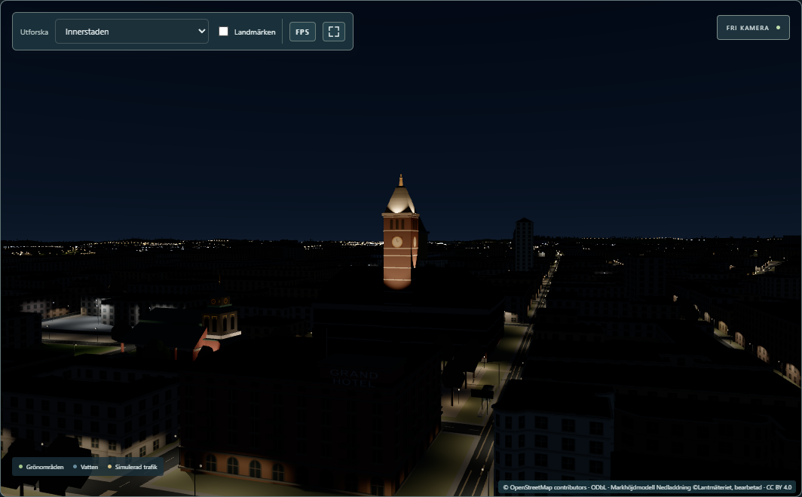
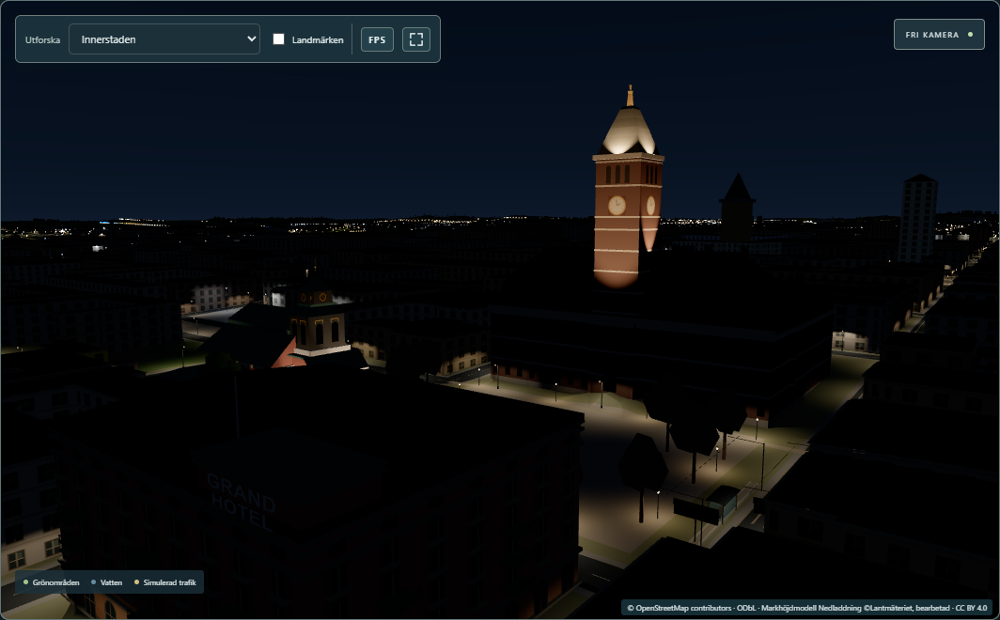

# Landmark Phase B1 part 2 — Rådhuset's tower floodlit at night (2026-11-07)

Worked directly on local `main` (= `origin/main` `39d4c0f`). Tested locally and approved by the user, **committed (`700c8be`) and pushed to `origin/main`** (2026-11-07). Backend unchanged.
Roadmap track B, step B1 part 2. Part 1 (the measured town hall, Gull-Olle) is
[docs/landmark-b1/README.md](../landmark-b1/README.md).

## Result

- **The tower is floodlit at night, as in the 2017 photograph.**
  - **Lit:** the shaft above the main roof (its bands, the clock and the belfry), the cornice, the
    pyramid roof (the brightest part) and Gull-Olle, in a warm golden light.
  - **Dark:** the town hall's façades below; only the street lamps light them, as in the
    photograph.
  - **By day:** nothing changes.
- **Evidence:** a Commons night photograph from 2017-11-30, taken from the north bank of Motala
  ström (CC BY 4.0), and a dawn photograph from 2019 with the spire still lit.

  No document describes the fixtures, so the eight fixtures are **estimates** placed where they can
  reproduce the photograph:
  - one on Tyska torget for the north face;
  - one on the courtyard block's ridge for the south face;
  - two on the north wing's roof for the east and west faces;
  - four on brackets at the cornice for the roof and the statue.

  The light colour is a warm white of about 2200 K. On the surfaces this gives 54–205 lux on the
  shaft faces at 45 m and 374 lux on each roof face. *Lux* measures how much light falls on a
  surface; a lit street gets 10–20 lux.
- **The same technique as Hedvigs kyrka (B2):** the fixtures are façade emitters in the city's lighting
  shader. There are no new light objects, no new shader programs (20 by day and at night) and no new
  meshes; **Rådhuset's geometry is byte-identical** to part 1. Together with Hedvigs kyrka the 16
  façade slots are now full ([remaining-gaps.md](remaining-gaps.md) §3).




More: [Tyska torget at night](evidence/02-night-tyska-torget.png), [the tower at night](evidence/03-night-tower.png),
[the same view by day](evidence/05-day-tower.png) (camera positions: [shots.json](evidence/shots.json)).

## How it is built

| Part | Where | What |
|---|---|---|
| Values | [`radhuset/spec.ts`](../../src/lib/landmarks/radhuset/spec.ts) `FLOODLIGHTS`, `FLOOD_COLOR_WARM` | Each fixture in Rådhuset's building frame: position, mounting height (absolute `z` on a roof or the cornice, or `height` above the ground on the square), aim point, beam angles, candela, range. Everything is tagged `[NIGHT]` or `[EST]` |
| Conversion | [`landmarks/floodlights.ts`](../../src/lib/landmarks/floodlights.ts) (new) | `toFacadeEmitters()`: building frame → scene-space façade emitters. Shared with Hedvigs kyrka; Hedvig's emitters are unchanged by the move |
| Wiring | [`radhuset.ts`](../../src/lib/landmarks/radhuset/radhuset.ts) `radhusetFloodlights()`, [`mapView.ts`](../../src/lib/mapView.ts) | `createRadhuset()` returns `floodlights`; the map passes Hedvig's and Rådhuset's to the lighting controller |

## Measured

Paired timing against `origin/main` `39d4c0f`, which already includes Hedvigs kyrka's 8 floodlights.
Set-up:
- hook builds, fullscreen 2560×1440;
- traffic on, Edge headless, uncapped, 600 frames per view;
- 5 rounds; B2's harness `scripts/landmark-b2/paired.mjs`.

Each difference is to `main` in the same round: median [min … max], in ms. *rAF* is the time
between two frames as the viewer sees it; *p95* is the time that 95 % of the frames stay under.

| View | `main` rAF mean | B1 part 2 | rAF mean | rAF p95 | Draw calls |
|---|---:|---:|---:|---:|---:|
| Centrum, night | 1.77 ms | 1.80 | +0.03 [+0.02 … +0.05] | 0.00 [−0.10 … +0.10] | 351 → 351 |
| Centrum, day | 1.65 | 1.63 | −0.02 [−0.04 … +0.05] | 0.00 [−0.20 … +0.10] | 350 → 350 |
| Innerstaden, night | 3.15 | 3.17 | +0.02 [−0.16 … +0.21] | 0.00 [−0.10 … +0.20] | 912 → 912 |
| Overview, night | 3.55 | 3.57 | +0.02 [−0.16 … +0.20] | 0.00 [−0.20 … +0.10] | 1 649 → 1 649 |

**Reading:** no measurable cost. The extra cost is at most a few hundredths of a millisecond, and
there are no extra draw calls or triangles. Data: [data/paired.json](data/paired.json)
([summary](data/paired-summary.md)).

## Checks

| Check | Result |
|---|---|
| `npm run check` (type check) | 0 errors, 0 warnings (1 217 files) |
| `npm run build` | OK |
| Vitest (PowerShell, `C:\` path) | 594 / 595. The new `radhuset/floodlights.test.ts` passes 3 / 3; B1's `radhuset.test.ts` and B2's `hedvig.test.ts` pass unchanged. The one failure is the known `police.test.ts` (CRLF line endings in this checkout; unrelated) |
| Playwright, full suite (28 tests including the new `landmark-radhuset-lights.spec.ts`), `phase0-e2e` + `phase0-backend` | 28 / 28 |
| Rådhuset's geometry | vertex-buffer SHA-256 `12b2569b…44e504`, identical to part 1 |
| In the running app | screenshots above (`scripts/landmark-b1-2/shots.mjs`); 16 façade emitters on at night, 0 by day; 20 shader programs in every shot |

What the new tests check:
- `floodlights.test.ts`:
  - there are eight fixtures with the warm colour, all aimed up;
  - the square flood stands on the ground and the cornice floods sit at the cornice;
  - every shaft face and every roof face gets 50–400 lx on its surface, the statue gets light, and
    the north façade below gets under 1 lx;
  - with Hedvigs kyrka the 16 slots are exactly full and one zone holds all of them.
- `landmark-radhuset-lights.spec.ts`:
  - by day 0 of the 16 emitters are on, at night all 16;
  - the program count is the same by day and at night;
  - at night the shaft (screen brightness 88, on a 0–255 scale) and the roof (159) are much
    brighter than the north façade (3).

**Changed in an earlier phase's test.** `tests/landmark-hedvig.spec.ts` (B2) expected 8 façade
emitters in total. It now counts Hedvig's own emitters by name (still 8) and expects all emitters on
at night. The check is as strict as before; only the other landmark's lights were added.

## Files

- **New:**
  - `src/lib/landmarks/floodlights.ts`
  - `src/lib/landmarks/radhuset/floodlights.test.ts`
  - `tests/landmark-radhuset-lights.spec.ts`
  - `scripts/landmark-b1-2/shots.mjs`
  - `docs/landmark-b1-2/` (this report, provenance, gaps, data, evidence)
- **Changed:**
  - `src/lib/landmarks/radhuset/{spec,radhuset}.ts`: added lines only; the geometry is unchanged
  - `src/lib/landmarks/hedvig/{spec,hedvig}.ts`: use the shared conversion; the same emitters
  - `src/lib/mapView.ts`
  - `tests/landmark-hedvig.spec.ts`
  - `docs/landmark-b1/remaining-gaps.md` (a pointer to part 2)
  - `.gitignore`: `/work/landmark-b1-2/`
  - `docs/board/board.json`, `docs/roadmap.md`, `docs/claude-progress.md`
- **Local only:**
  - `.claude/launch.json` (`b12-main` 5333, `b12-new` 5334)
  - `work/landmark-b1-2/`. The temporary `origin/main` worktree was removed.

## Reproduce

```
npx vitest run src/lib/landmarks/radhuset                    # PowerShell, uppercase C:\ path
E2E_BASE_URL=http://127.0.0.1:5194 npx playwright test tests/landmark-radhuset-lights.spec.ts
node scripts/landmark-b1-2/shots.mjs http://127.0.0.1:5193 <new-dir>                  # phase0-dev
# hook builds (VITE_LIGHTING_HOOK=1) of origin/main (worktree) and of the working tree; preview b12-main 5333, b12-new 5334
MAX_BUSY=18 node scripts/landmark-b2/paired.mjs <new.json> 5 main=http://127.0.0.1:5333 b12=http://127.0.0.1:5334
```

See also [data-provenance.md](data-provenance.md) and [remaining-gaps.md](remaining-gaps.md).
