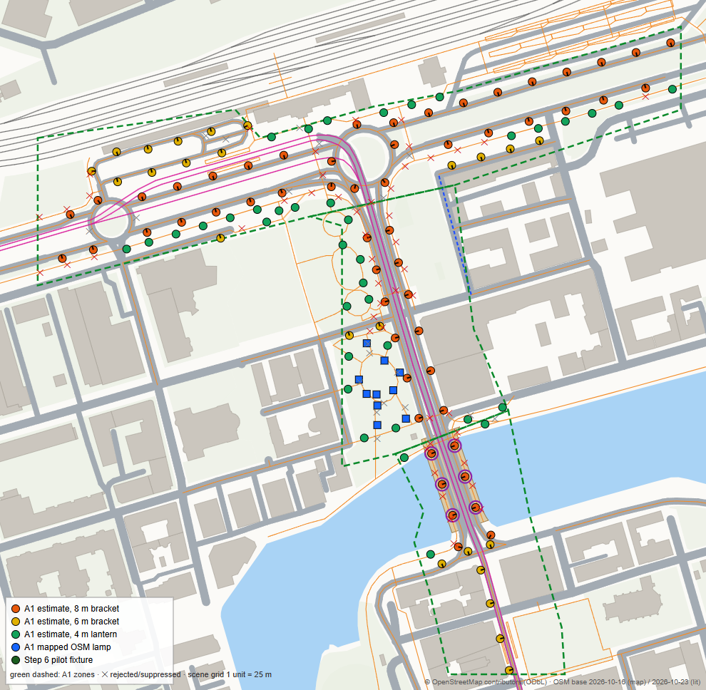
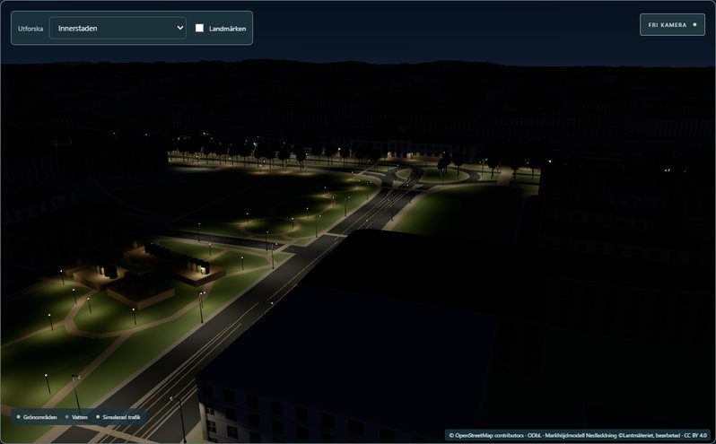
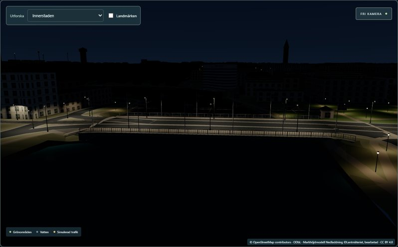

# Lighting Phase A1 — central city corridor (Resecentrum · Norra Promenaden · Drottninggatan · Saltängsbron)

Implemented 2026-10-24 (Europe/Stockholm) in the UI repository on branch `codex/lighting-phase0`, on top
of the uncommitted, approved Phase 0 work. **Not committed, pushed or merged.** Backend unchanged.

**In one line:** 127 new fixtures (10 mapped OSM lamps + 117 labelled estimates on `lit=yes` ways)
light a bounded 0.083 km² corridor through the real shader lighting; the combined 232-fixture set fits
the 16-lamp cell capacity (max 15) with no overflow; the 105 pilot fixtures are bit-identical and every
pilot view is pixel-identical; measured performance stays within the gates.

| Report | Content |
|---|---|
| [coverage.md](coverage.md) | exact EPSG:3006 boundary, what is lit and what is not, distance to the pilots |
| [data-provenance.md](data-provenance.md) | sources, snapshot dates, licences, identity, the placement policy, municipal precedence |
| [capacity-report.md](capacity-report.md) | occupancy, near-capacity cells and their contributors, density headroom, rejection behaviour |
| [performance.md](performance.md) | paired production benchmarks, draw calls, build/upload, memory, lifecycle |
| [visual-validation.md](visual-validation.md) | before/after captures, noise floor, pilot preservation, final night views, inspection overlay |
| [remaining-gaps.md](remaining-gaps.md) | data still needed, modelling limits |
| [data/](data/) | machine-readable registry lines, coverage, capacity, under-deck light, performance, visual diff, manifest |

## 1. Starting state (verified)

| | UI | Backend |
|---|---|---|
| HEAD | `bf5f726` on `codex/lighting-phase0` | `3673568` on `main`, clean |
| Working tree | Phase 0 uncommitted: 9 modified + 12 untracked paths (incl. untracked `.claude/launch.json`), as reported | — |

Before any edit, the exact Phase 0 working-tree files (53) were copied with a SHA-256 list to ignored
`work/lighting-a1/phase0-snapshot/`; a frozen Phase 0 reference app (`git archive bf5f726` + that
snapshot, 0 mismatches) under `work/lighting-a1/phase0-app/` served as the "before" for all paired
captures and benchmarks. No reset, stash, checkout, merge or history change. `/work/lighting-a1/` was
added to `.gitignore`. No new dependency.

## 2. Fixtures

| Zone | 8 m bracket | 6 m bracket | 4 m lantern | Total | Mapped | Estimated |
|---|---:|---:|---:|---:|---:|---:|
| A — Resecentrum & Norra Promenaden | 35 | 15 | 22 | **72** | 0 | 72 |
| B — Drottninggatan (to Saltängsbron) | 12 | 2 | 23 (10 mapped) | **37** | 10 | 27 |
| C — Saltängsbron & south connection | 8 (6 on the deck) | 7 | 3 | **18** | 0 | 18 |
| **A1** | **55** | **24** | **48** | **127** | **10** | **117** |
| Pilot (unchanged) | | | | 105 | 10 | 95 |
| **Rendered total** | | | | **232** | 20 | 212 |

Estimates by rule: 49 dual-carriageway outer kerb, 6 roundabout outer kerb, 24 one-side, 38 lanterns
beside paths. 71 candidates were not placed, all reported with reasons: 50 path stations covered by a
lit road within 10 m, 14 suppressed by a nearer estimate, 7 by a mapped lamp; **0** for lack of a
valid position. Effective spacing 14.3–35.0 m (way-local, no jitter).

Mapped vs estimated: the 10 mapped lamps are OSM `highway=street_lamp` nodes (mapped 2023-08-08, not
surveyed) in the small square south of the park beside Drottninggatan; all other positions are
estimates and labelled as such in every record (`placement`, `illumination`, `position.status`,
provenance `observed`/`inferred`).



## 3. Import and de-duplication

1. **Source:** the pinned Step 6.2 OSM snapshot (base 2026-10-23T09:05:06Z, SHA-256 verified) clipped
   to the corridor + 60 m into the committed 68 KB extract `scripts/data/lighting-a1-source.json`
   (`scripts/lighting-a1/extract-source.mjs`). No new download.
2. **Generator:** `src/lib/lighting/corridorGenerator.ts`, a pure function of pinned inputs (extract,
   rendered map, bridge outlines/profiles, terrain-derived deck occluders, platforms, Step 6 type
   table, pilot fixtures). Inputs are sorted before use; acceptance runs in canonical priority order.
   Outputs: `src/lib/data/streetlights-a1.json` (runtime, bundled) and
   `streetlights-a1-provenance.json` (not bundled). Regeneration is byte-identical (tested);
   shuffling every input list changes nothing (tested).
3. **IDs:** `osm:node/<id>` and `estimate:lighting-a1-v1:way/<id>:s<n>` — canonical = runtime ID, the
   generator version is part of each estimate ID, so A1 and pilot estimates cannot collide; a merged
   set with a duplicate canonical ID is rejected as a whole (tested).
4. **Duplicates by identity, never by distance.** A mapped node already in the pilot is not re-imported.
   Proximity only suppresses *estimates* (never mapped or existing fixtures), with the reason recorded.
   Pilot records are untouched; the corridor does not touch any pilot (closest: Strömparken 45 m).
5. **Future municipal data:** `reconcileSources` (crosswalk entries supersede OSM records; an
   authoritative register's declared coverage supersedes estimates; mapped records without a crosswalk
   go to review; nothing merged by distance). Implemented and tested with synthetic records, not used.

Placement (details: [data-provenance.md](data-provenance.md#placement-policy-lighting-a1-v1)): real
road alignment and rendered widths; outer-kerb rows on dual carriageways; 0.8 m kerb setback; no pole
in any carriageway (incl. junctions), within 2.2 m of a tram track or 3 m of a railway, on a platform,
in water, inside or 0.6 m from a building, under a deck; deck lamps on the deck profile; tram-street
poles set back to 4.05 m; ground/deck support derived at runtime (no floating or buried bases —
tested). Ground lamps treat decks with covered space as occluders: **0 lux through Saltängsbron's deck**.

## 4. Capacity and overflow

Policy unchanged (25 m cells, 16 slots, 100 m pages, full-set rejection, no truncation, previous set
kept). **Combined 232 fixtures: accepted, max 15, 0 overflow cells**, 476 non-empty cells, 63 pages.
The busiest cell (15) is the square with 8 real mapped lamps plus overlapping road brackets — real
mapped density, not estimate spacing. Headroom is about one lamp: estimates at 85 % spacing would
overflow that cell (17, rejected with the full contributor list). The Phase 0 synthetic overflow cell
(−8, −23) lies in zone B and holds 13 lamps under the A1 policy. [capacity-report.md](capacity-report.md)

## 5. Visual grouping

Smallest citywide-compatible change: the registry's `group` is now a **fixed geographic chunk** for A1
records (`chunk:<cx>,<cz>`, 32 × 32 light cells = 800 m, aligned with the 100 m index pages; key from
the base position only — `corridorA1.groupKey`). `fixtures.ts` is unchanged: it already instances per
(group, type) with shared geometry and materials and selects detail by the distance to the group's
nearest bound, so nothing nearby can be hidden (tested over 300 cameras, > 10 000 checks). A1 uses 2
chunks → ≤ 14 extra draw calls; pilot groups keep their names so the frozen pilot visuals stay
bit-identical. Lighting itself does not depend on groups: lamps illuminate receivers across chunk
boundaries through the global sparse index (tested). No streaming, no per-lamp mesh, material or
dynamic light; no camera-dependent lighting.

## 6. Illumination evidence

Screenshots: [visual-validation.md](visual-validation.md) and [evidence/night/](evidence/night/).
Roads, pavements, park paths, the station forecourt, facades and the bridge deck are lit by the
existing shader lighting; areas between streets and `lit=no`/untagged streets stay dark; no ambient
or exposure change. E2E: mean frame luma at the Drottninggatan pose 15.0 vs 7.0 (pilot only).




## 7. Performance (paired production runs, Phase 0 → A1)

Map-ready **−9 ms** pooled (series 1 +51, confirmation −110); post-GC heap **+0.32 MB**; max paired p95
+0.8 ms pooled; day p95 +0.6 ms in the `city` view whose day draw work is identical in both builds
(noise at this method's ±1 ms resolution). Per view at most +12 calls / +12.7 k triangles. Pre-upload
pipeline 0.79 → 1.09 ms (Node), upload submission 2.8 → 2.9 ms. Textures 54 920 → 95 072 B (CPU
arithmetic, not VRAM). 20 shader programs in every state. App chunk +6.0 KB gzip.
[performance.md](performance.md)

## 8. Tests

| Suite | Result |
|---|---|
| Type check (`svelte-check`) | 0 errors, 0 warnings |
| Production build | succeeds (pre-existing > 500 kB chunk warning only); generator, inspector, precedence and provenance not in the bundle |
| Vitest (`vitest run`) | **26 files, 307 tests passed** (279 Phase 0-era + 28 new A1 in `corridor.test.ts`) |
| Step 6.2 historical grid audit | 3/3 |
| Phase 0 harnesses | manifest + synthetic city pass (see note), freeze-baseline skipped by design |
| A1 harnesses (`scripts/lighting-a1`) | write (byte-identical), reports, timing pass |
| Playwright (`tests/`, isolated backend copy of `3673568` on 8095, E2E dev server on 5194) | **7/7**: lighting ×4 (incl. the new A1 test), live Bergsbron bus/truck regression, transit, simulation |
| `git diff --check` | clean |
| Backend | not affected, not run (no backend change) |

A1 tests cover: byte-identical regeneration; input-order independence; pinned snapshot; counts; zone
membership; `lit=no`/untagged/platform/area exclusions; building/water/platform/deck/tram/rail/
carriageway clearances; supports (no floating/buried bases); 0 lux through the deck (ray test);
clearance from pilots; merged validation and ID disjointness; pilot records deep-equal; capacity ≤ 16;
pilot lamp rows bit-identical inside the combined set; frozen pilot cells unchanged; frozen pilot
instance transforms; combined output = manifest hashes; shuffled combined set byte-identical; chunk
grouping; no hidden nearby lamp; cross-group illumination; ID collision, 17-lamp overflow and invalid
geography rejected with the previous set kept; 10 alternating set replacements with constant
resources; municipal precedence. E2E adds swaps, rejection, recreation and context restoration on the
live map with byte-identical frames.

Note: running the Phase 0 harness suite re-executes its writers; during this work that overwrote
`docs/lighting-phase0/measurements/registry-manifest.json` and `synthetic-city.json`. Both were
restored byte-for-byte from the snapshot, and the manifest writer now passes the pilot registry
explicitly so a rerun keeps describing the pilot. Phase 0 evidence is unchanged.

## 9. Remaining unknowns

Positions of 117 fixtures are estimates; no municipal register, photometry, switching, RH2000 pole
heights; 29 corridor ways have no `lit` tag (incl. most of the Drottninggatan tram street south of the
bridge); platforms and Tyska torget unlit by design. [remaining-gaps.md](remaining-gaps.md)

## 10. Recommended next rollout area

**A2 — Norra Promenaden west to Kungsgatan and Kungsgatan north to the pilot** (west of zone A, x −27…−18 /
z −26…−15 scene units): ≈ 570 m of `lit=yes` secondary carriageway in the same pinned snapshot
(Norra Promenaden 4384887, 4384888, 286445689, 286445690, 300186799; Kungsgatan 92385198, 92385220,
297613947, 297613948, 444474486, 444474489). It joins A1 and the Kungsgatan pilot into one continuous
lit network, is mostly 8 m brackets on dual carriageways without a mapped-lamp cluster (low capacity
risk), and exercises the tram-envelope rule at the Norrtull tram stop. A bridge-heavy
alternative (Hamnbron/Packhusrondellen east of A1) would need the deck-occluder rule reviewed per
bridge first. Either should wait for a decision on the municipal register request.

## 11. Files and proposed checkpoint (not executed)

New (A1): `src/lib/lighting/{corridorA1,corridorGenerator,corridorRegistry}.ts`,
`src/lib/lighting/corridor.test.ts`, `src/lib/inspectLighting.ts`,
`src/lib/data/streetlights-a1.json`, `src/lib/data/streetlights-a1-provenance.json`,
`scripts/data/lighting-a1-source.json`, `scripts/lighting-a1/` (extract, inputs, write, reports,
timing, corridor map, poses, vitest config), `docs/lighting-phase-a1/`.

Modified Phase 0 files (A1 part only; exact diff in ignored
`work/lighting-a1/a1-changes-to-phase0-files.patch`): `controller.ts` (default set = pilot + A1,
`a1LightingRegistry`, `runtimeLightingRegistry`, `inspect()`, rollout counts), `streetLighting.ts`
(records + rollout counts in the prepared set), `Scene.svelte` (DEV hooks: registries, replace,
inspect, `?inspect=lighting`), `phase0.test.ts` (frozen tests use the pilot explicitly),
`tests/lighting.spec.ts` (232 fixtures; new A1 E2E test), `scripts/lighting-phase0/{capture,measure,
view-calls}.mjs` (optional `POSES`/`STATES`/`VIEWS`), `diff.py` (optional `LABELS`),
`manifest.test.ts` (explicit pilot registry), `.gitignore` (`/work/lighting-a1/`),
`docs/claude-progress.md`.

Proposed checkpoint, two commits so Phase 0 stays reviewable on its own:
1. **Lighting Phase 0** — exactly the files in `work/lighting-a1/phase0-snapshot/` (52 paths; not
   `.claude/launch.json`).
2. **Lighting Phase A1** — everything above on top.

Exclude `.claude/launch.json` (untracked helper; A1 added `a1-*` server entries), `work/`, `dist/`,
`test-results/`. No raw OSM snapshot or large benchmark files are in the docs (largest: 434 KB map
image).

## 12. Reproduction (PowerShell, UI checkout)

```powershell
node scripts/lighting-a1/extract-source.mjs            # needs the ignored Step 6.2 snapshot; verifies its SHA-256
$env:WRITE='1'; .\node_modules\.bin\vitest.cmd run -c scripts/lighting-a1/vitest.config.ts write; Remove-Item Env:WRITE
.\node_modules\.bin\vitest.cmd run -c scripts/lighting-a1/vitest.config.ts reports   # docs/lighting-phase-a1/data
.\node_modules\.bin\vitest.cmd run                     # includes corridor.test.ts
node scripts/lighting-a1/corridor-map.mjs docs/lighting-phase-a1/evidence/corridor-map.png
# Paired captures (DEV servers: Phase 0 reference app on 5195, A1 on 5196):
$env:POSES='scripts/lighting-a1/poses.json'; $env:STATES='day,twilight,night,training,match'
node scripts/lighting-phase0/capture.mjs work/lighting-a1/captures/after http://127.0.0.1:5196/
# Paired performance (vite preview: Phase 0 reference on 5197, A1 on 5198):
$env:VIEWS='station,grandHotel,centrum,city,kungsgatan,stromparken,idrottsparkenPitch,parken'
node scripts/lighting-phase0/measure.mjs work/lighting-a1/perf/run.json 3 5197 5198
```
