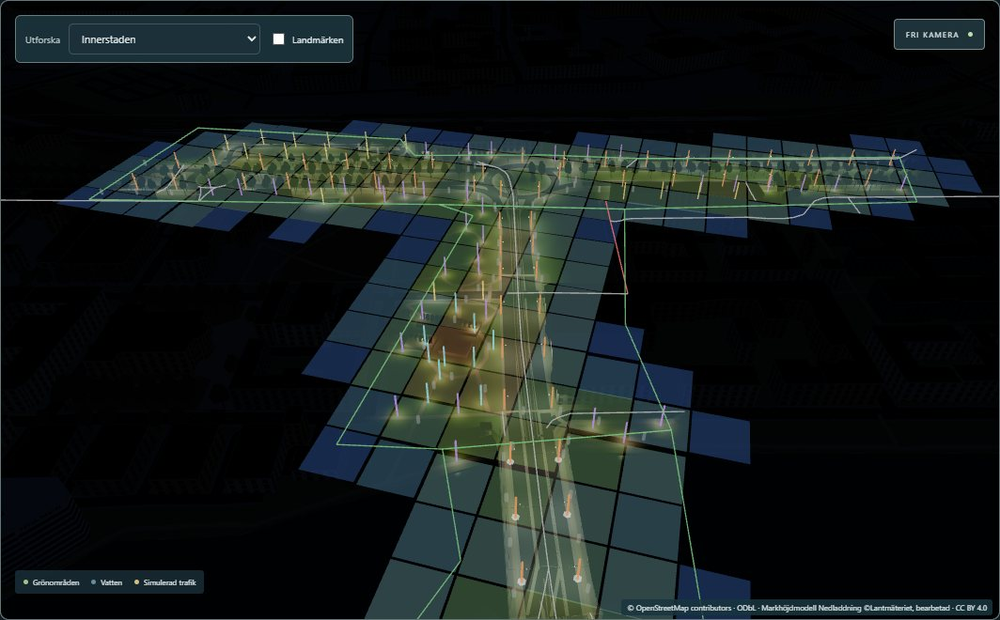

# Phase A1 — visual validation

Paired captures with Phase 0's tool (`scripts/lighting-phase0/capture.mjs`, now with optional `POSES`
and `STATES` env overrides; defaults unchanged) against two DEV servers: the frozen **Phase 0
reference** (5195) and **A1** (5196), then a second Phase 0 run as the noise floor. Identical poses,
1400 × 1000, DPR 1, Edge 156 / ANGLE D3D11 / RTX 5070 Ti, date 2026-10-21, Europe/Stockholm, labels off,
traffic API aborted. States: day 12:39, twilight 17:52, night 21:30 (stadium off), and for the stadium
and pilot overview also TRAINING and MATCH. 17 poses (8 new A1 poses in
[`scripts/lighting-a1/poses.json`](../../scripts/lighting-a1/poses.json), 9 Phase 0 poses) → **57 images
per build**. Comparison without tolerance (`diff.py`): [data/visual-diff.json](data/visual-diff.json);
capture metadata (programs, fixtures, calls, triangles per image):
[data/capture-metadata.json](data/capture-metadata.json). Raw PNGs stay in ignored
`work/lighting-a1/captures/`.

## Noise floor

Phase 0 vs a second Phase 0 run: **7 pixels at 1 level in 1 of 57 images** (`a1-resecentrum-elevated-day`).

## Pilot preservation (33 pilot-pose images)

| Views | Result |
|---|---|
| Kungsgatan street + elevated, Bergsbron north end, Strömparken path, stadium pitch + elevated (all states incl. TRAINING/MATCH), pilot overview by day, city overview by day | **24 images byte-identical** (0 changed pixels) |
| Strömparken elevated | day 58 px, twilight 2 603 px, night 2 492 px — all inside the top-right corner (x ≥ 978, y ≤ 62): the A1 corridor appearing on the horizon. [Triptych](evidence/visual/stromparken-elevated-night.jpg) |
| Pilot overview (twilight, night, TRAINING, MATCH) | 6 711–6 737 px inside x 673–921, y 71–219: the new corridor lights in the distance; Kungsgatan, Strömparken and the stadium areas unchanged. [Triptych](evidence/visual/pilot-overview-night.jpg) |
| City overview (twilight, night) | 1 348–1 355 px inside x 524–621, y 205–269: the corridor. [Triptych](evidence/visual/city-overview-night.jpg) |

Shader programs: **20 in all 57 captures of both builds** (every day/night/stadium state). The unit
tests also prove the pilot's lamp rows are bit-identical inside the combined set, its 279 cells list
exactly its own lamps, and its fixture instance transforms equal the frozen baseline.

## Corridor: before (Phase 0) | after (A1) | |difference| × 16

| View | Night | Twilight / day |
|---|---|---|
| Resecentrum, street level | [night](evidence/visual/a1-resecentrum-street-night.jpg) | |
| Resecentrum, elevated | [night](evidence/visual/a1-resecentrum-elevated-night.jpg) | [day](evidence/visual/a1-resecentrum-elevated-day.jpg) |
| Norra Promenaden, street level | [night](evidence/visual/a1-norra-promenaden-street-night.jpg) | |
| Drottninggatan, street level | [night](evidence/visual/a1-drottninggatan-street-night.jpg) | |
| Drottninggatan, elevated | [night](evidence/visual/a1-drottninggatan-elevated-night.jpg) | [twilight](evidence/visual/a1-drottninggatan-elevated-twilight.jpg) |
| Saltängsbron, on the deck | [night](evidence/visual/a1-saltangsbron-street-night.jpg) | |
| Saltängsbron, from the east bank | [night](evidence/visual/a1-saltangsbron-side-night.jpg) | |
| Central city overview | [night](evidence/visual/a1-central-overview-night.jpg) | |
| Kungsgatan street (pilot, unchanged) | [night](evidence/visual/kungsgatan-street-night.jpg) | |

Final A1 nighttime views (¾ resolution): [evidence/night/](evidence/night/) — Resecentrum street and
elevated, Norra Promenaden, Drottninggatan street and elevated, Saltängsbron deck and side view, central
overview, plus Drottninggatan elevated by day and at twilight.

## What the images show

- **Road and pavement illumination**, not just glowing poles: light pools on both Drottninggatan
  carriageways, the roundabout, Norra Promenaden's outer kerbs and central promenade, the park
  footways and the station forecourt. Changed pixels per corridor street/elevated view at night: 117 k–361 k
  (mean channel change 6–28 levels; 28 k in the overview); by day only the new poles/lenses (0.35 k–11.5 k px). E2E: mean frame luma ×2.1 at the
  Drottninggatan pose with A1 vs pilot only.
- **Facade spill:** the station building front and the buildings beside Drottninggatan and at the
  south bridgehead catch light; walls behind the lamps stay dark (building occlusion sectors).
- **Bridge:** Saltängsbron's deck is lit by its six deck lamps; the water under the deck stays dark
  (difference image black under the deck). CPU ray test: 0 lux through the deck, ≤ 3.5 lux entering
  from the open sides at the outline ([data/underdeck.json](data/underdeck.json)).
- **Dark between streets:** blocks, the park interior west of the corridor, Magasinsgatan (`lit=no`)
  and the untagged streets stay dark; no ambient or exposure change (the environment code is
  untouched). In the overviews, lighting ends at the zone boundaries.
- **Twilight:** lamps switch with the same solar-night activation as the pilot.

## In-scene inspection

`?inspect=lighting` on a DEV server (`src/lib/inspectLighting.ts`, never in production builds):
runtime fixtures as solid pins by rollout/evidence/type, research-only candidates as grey stubs, zone
outlines, `lit=no` (red) and untagged (grey) ways, deck supports and light-grid occupancy tiles;
`globalThis.__lightingInspection` lists status, occupancy histogram, near-capacity cells with their
contributing IDs, rejected candidates and missing-evidence ways. DEV `__cityLighting.inspect()` lists
every rendered fixture (ID, rollout, group, evidence, type, support, E/N).

