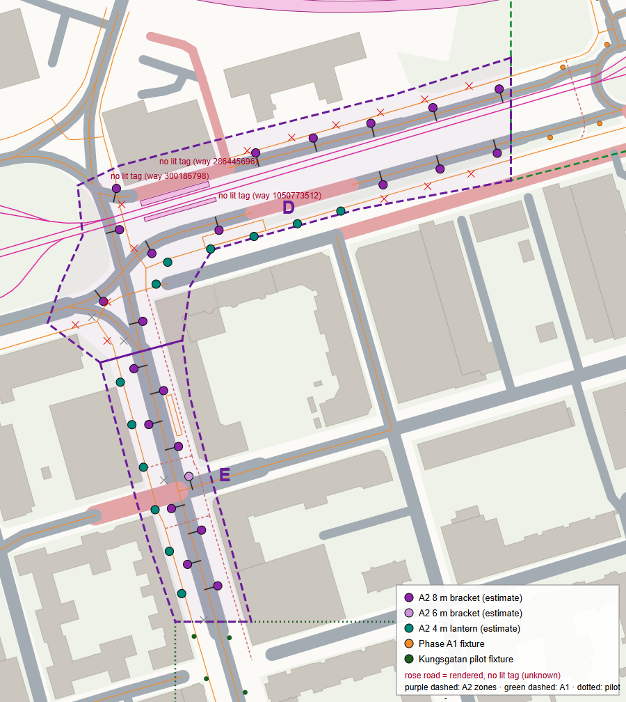

# Lighting Phase A2 — western Norra Promenaden and northern Kungsgatan

Implemented 2026-10-24 (Europe/Stockholm) in the UI repository on branch `codex/lighting-phase-a2`,
created from the committed Phase A1 state `1fe6296`. **Not committed, pushed or merged.** Backend
unchanged (`3673568`).

**In one line:** 35 new labelled estimates on `lit=yes` streets and paths connect the Phase A1
corridor and the Kungsgatan pilot into one continuous lit network; the combined 267-fixture set fits
the 16-lamp cell capacity (max 15, unchanged; A2 cells ≤ 9) with no overflow; the 232 earlier fixtures
are bit-identical; both rollout seams are continuous; two short untagged carriageway pieces at the
Norrtull tram stop stay unlit pending evidence (decision below).

| Report | Content |
|---|---|
| [coverage.md](coverage.md) | exact EPSG:3006 boundary, how it was derived, seams, what is lit and what is not |
| [data-provenance.md](data-provenance.md) | sources, snapshot, licence, identity, the A2 seam rules, skipped candidates |
| [capacity-report.md](capacity-report.md) | occupancy, A2 and seam cells, headroom, rejection behaviour |
| [visual-validation.md](visual-validation.md) | before/after captures, noise floor, seams, reference views, illuminance at the seams |
| [performance.md](performance.md) | paired production benchmarks vs committed A1, draw calls, build/upload, memory, lifecycle |
| [remaining-gaps.md](remaining-gaps.md) | the Norrtull evidence gap and its options, data still missing, modelling limits |
| [data/](data/) | machine-readable registry lines, coverage, capacity, seam profiles, manifest |

## 1. Starting state (verified)

| | UI | Backend |
|---|---|---|
| HEAD | `1fe6296` (A1) on top of `b40908a` (Phase 0), branch `codex/lighting-phase0`, local only | `3673568` on `main`, clean |
| Working tree | clean except the user's untracked `.claude/` | clean |
| Action | new branch `codex/lighting-phase-a2` at `1fe6296` | none |

No reset, stash, rebase, merge, push or commit. `.claude/` was not staged; five `a2-*` server entries
were **added** to the untracked `.claude/launch.json` (all existing entries kept; the original is
backed up in ignored `work/lighting-a2/launch.json.before`). `/work/lighting-a2/` was added to
`.gitignore`. No new dependency, no re-import of map/terrain/road data, no network request.

## 2. Corridor

Two zones, 0.0198 km², **D** = Norra Promenaden from A1's west edge to the Kungstorget east junction
(incl. the Norrtull tram stop), **E** = Kungsgatan from Kungstorget to the pilot's north bound (incl.
the Slottsgatan junction mouth). D's east edge lies on A1 zone A's west edge (shared vertex); E's
south edge lies on the pilot's north bound; no overlap with A1 or the pilot (tested).
Details and vertex tables: [coverage.md](coverage.md).



## 3. Fixtures

| Zone | 8 m bracket | 6 m bracket | 4 m lantern | Total | Mapped | Estimated |
|---|---:|---:|---:|---:|---:|---:|
| D — Norra Promenaden west, Norrtull, Kungstorget east junction | 14 | 0 | 6 | **20** | 0 | 20 |
| E — Kungsgatan north, Slottsgatan junction | 8 | 1 | 6 | **15** | 0 | 15 |
| **A2** | **22** | **1** | **12** | **35** | **0** | **35** |
| Pilot (unchanged) | | | | 105 | 10 | 95 |
| A1 (unchanged) | | | | 127 | 10 | 117 |
| **Rendered total** | | | | **267** | **20** | **247** |

No mapped OSM lamp exists in the corridor (0 nodes in the pinned snapshot), so every A2 fixture is an
estimate, labelled as such in every record. Rules: 11 dual-carriageway outer kerb, 2 roundabout
(circular junction) outer kerb, 1 one-side, 9 staggered (the 9.9 m two-way Kungsgatan), 12 lanterns
beside lit paths. Effective spacing 11.2–41.0 m (way-local; a single-station way reports its own length). 18 candidates skipped, all reported:
14 path stations covered by road lighting, 3 suppressed by an A2 estimate at junction splits, 1 by
the pilot's last Kungsgatan bracket (seam rule); 0 without a valid position.

## 4. Import, identity and duplicates

1. **Source:** the pinned Step 6.2 OSM snapshot (base 2026-10-23T09:05:06Z, SHA-256 re-verified),
   clipped to the A2 zones + 60 m into the committed 26 KB extract `scripts/data/lighting-a2-source.json`
   (`extract-source.mjs a2`; the A1 extract regenerates byte-identically).
2. **Generator:** the A1 generator `corridorGenerator.ts`, now taking a corridor spec (zones, generator
   version, dataset, policy). With the default A1 spec its output is byte-identical (tested).
   A2 policy `lighting-a2-v1` = A1's policy + two seam rules. Outputs
   `src/lib/data/streetlights-a2.json` (bundled) and `streetlights-a2-provenance.json` (not bundled);
   byte-identical regeneration and input-order independence tested.
3. **IDs:** `estimate:lighting-a2-v1:way/<id>:s<n>`; canonical = runtime ID; way-local station index;
   independent of the earlier rollouts and of the corridor bounds (tested).
4. **Duplicates by identity, never by distance.** Earlier records are inputs only (never moved,
   merged or removed). Seam rule 1: earlier *estimates* count as accepted estimates, so a continuing
   way keeps its spacing (one candidate skipped at the pilot seam, with the reason recorded). Seam
   rule 2: a station slot A1 already rendered is A1's fixture (Norra Promenaden 4384887: A1 `s0`,
   A2 `s1`, `s2`). Details: [data-provenance.md](data-provenance.md).

## 5. Capacity

**Combined 267: accepted, max 15 / 16, 0 overflow**, 538 non-empty cells, 69 pages, 105 696 B of
lighting textures (+10 624 B). The busiest cell is still A1's square (real mapped lamps). Every cell
an A2 lamp reaches holds ≤ 9; even 40 % denser A2 estimates fit (16). [capacity-report.md](capacity-report.md)

## 6. Seams, supports, occlusion, grouping

- **Continuity:** carriageway minima within ± 20 m of the seams 10.0 lux (pilot) and 5.3 lux (A1), not
  below the minima inside those rollouts (7.4 / 5.3 lux); before A2, 205 of 212 centreline samples on
  the A2 carriageways were < 0.5 lux. Junction maxima stay within A1's range (28.8 / 30.1 vs 30.6 /
  33.7 lux). No global exposure change. [visual-validation.md](visual-validation.md)
- **Supports:** all 35 on the rendered ground; emitter at the type's lens height (tested); no bridge
  within any A2 lamp's range, so no under-deck leakage is possible (tested); the A1 deck occluders and
  the Saltängsbron 0-lux ray test are unchanged.
- **Occlusion:** measured from the emitter (the A1 new-fixture convention; verified independently for
  all 35). The 105 frozen pilot fixtures keep their base-measured sectors.
- **Grouping/LOD:** A2 joins the fixed 800 m chunk group `chunk:-1,-1` with A1 (no new group, no new
  material); pilot groups unchanged. No lamp within the detail distance is hidden around A2 and both
  seams (300 cameras, > 10 000 checks). Lamps light receivers across group and rollout boundaries
  through the global index (tested).

## 7. Performance (paired production runs, committed A1 `1fe6296` → A2)

Series 1 (3 alternating rounds, idle machine, Edge 156 / RTX 5070 Ti, 10 views × day / night-off /
night-match): map-ready **−2.8 ms** (3 701.8 → 3 699.0); post-GC heap **+0.055 MB**; max paired p95
**+0.4 ms**; max day p95 **+0.3 ms** (inside the method's ±1 ms resolution, also in A2-free views); per
view at most **+7 calls / +15.7 k triangles**; textures **+10 624 B** (CPU arithmetic, not VRAM);
**20 programs** in every state; App chunk +12.3 KB (+2.3 KB gzip); pre-upload pipeline 0.88 → 1.03 ms
(Node). Two later series ran while a GPU-heavy game was running on the same machine (map-ready 5–10 s in
both builds, deltas −10…+21 ms in both directions): retained, flagged, not used. **A re-run on an idle
machine is recommended before acceptance.** Lifecycle: resource plateau over 10 rebuilds + 10
recreations, swaps A1 ↔ A2 at constant resources, context restoration byte-identical.
[performance.md](performance.md)

## 8. Tests

| Suite | Result |
|---|---|
| Type check (`svelte-check`) | 0 errors, 0 warnings (1 154 files) |
| Production build | succeeds (pre-existing > 500 kB chunk warning only); generator code not in the bundle |
| Vitest (`vitest run`) | **27 files, 342 tests passed** (307 earlier + 35 new in `corridorA2.test.ts`), single worker. With default parallelism under the machine's load at the time (a game running), 5–7 geometry-heavy tests in other files hit the 5 s timeout (different ones per run); all pass when re-run — the Phase 0 report's known baseline issue |
| A1 tests on the accepted A1 state | `corridor.test.ts` 28/28 (now pinned to pilot + A1 explicitly) |
| A2 harnesses (`scripts/lighting-a2`) | write (byte-identical), reports, timing pass |
| A1 harnesses | write (A1 files byte-identical with the shared generator), timing pass; A1 reports **not re-run** (they would rewrite A1 evidence) |
| Phase 0 harnesses | manifest + synthetic city pass, freeze skipped by design; their writers rewrote two Phase 0 evidence files (timings/hashes only) — **restored to the committed content** (as happened in A1) |
| Step 6.2 historical grid audit | 3/3 |
| Playwright (isolated backend copy of `3673568` on 8095, E2E dev server on 5194) | lighting **5/5** (time of day, context loss, Phase 0 lifecycle, A1, **new A2**), live Bergsbron bus/truck regression **pass**, transit **pass**; `simulation.spec.ts` **fails** (second tab: `.sim-metrics` not found within 5 s) — it fails identically against the committed A1 app (`1fe6296`) with the same backend, i.e. not caused by A2 (the Phase 0 report lists this second-tab timeout as a known baseline issue) |
| `git diff --check` | clean |
| Backend | not affected, not changed, not run (no backend change) |

New A2 test coverage: byte-identical generation, pinned snapshot, input-order independence (incl.
earlier rollouts), stable IDs independent of earlier rollouts and bounds, provenance/unknowns per record,
zone geometry (simple, no overlap with A1/pilot/each other, shared seam edges), ownership, exclusions
(untagged, platforms, rest of Kungstorget), clearances, ground supports and mounting heights, no deck in
reach, emitter-based occlusion (independent recomputation), ID disjointness, no doubled estimates,
A1 station-slot continuation, identity guards (slot / OSM node), the pilot-seam suppression, earlier
records untouched, combined validation (267), 232 earlier records deep-equal, 232 lamp rows bit-identical,
every A1-state cell keeps its lamps, capacity (max 15, A2 ≤ 9), frozen pilot visuals and A1 housing
transforms, manifest hashes, shuffled combined set, chunk grouping, LOD across seams, cross-corridor
influence (index = brute force), illumination continuity, 17-lamp rejection, A1-ID collision,
10 alternating replacements with constant resources. E2E adds live swaps, measured illumination, an
unchanged reference view, rejection, recreation and context restoration.

## 9. Decision needed and remaining unknowns

**Norrtull:** Norra Promenaden ways 286445696 + 300186798 (westbound, 50.5 m) and 1050773512
(eastbound, 52 m) have no `lit` tag although the carriageway on both sides is `lit=yes`; under the
approved policy they stay unlit (≈ 0 lux over ≈ 35–40 m of each centreline). Options — keep, OSM
check, an approved continuity rule, or a municipal register — in [remaining-gaps.md](remaining-gaps.md#1-decision-needed-the-untagged-norra-promenaden-pieces-at-norrtull).

All 35 positions are estimates; no municipal register, photometry, switching or RH2000 pole heights.

## 10. Recommended next scope

**A3 — close the evidence gap and finish Kungstorget** (small, low risk), in this order:
1. Decide the Norrtull question ([remaining-gaps.md](remaining-gaps.md#1-decision-needed-the-untagged-norra-promenaden-pieces-at-norrtull)).
   If an OSM `lit` check confirms the three pieces, regenerate A2 from a new pinned snapshot (2–4
   brackets); if a continuity rule is approved instead, implement it as `lighting-a2-v2`.
2. The rest of the **Kungstorget** ring (≈ 250 m, `lit=yes`, all secondary) plus the Stockholmsvägen
   and Norra Promenaden approaches west of it — bounded, connected to A2, estimate-only, low capacity risk.

Alternatively **Phase B** can start (Rådhuset / Gull-Olle geometry audit first, per the Step 6.2
rollout plan) — it is independent of A3. A bridge cluster (Hamnbron / Packhusrondellen) should wait
for a per-bridge review of the deck-occluder rule. Any of these should follow the decision on the
municipal register request, and the paired performance series should first be re-run on an idle machine.

## 11. Files and proposed checkpoint (not executed)

New (A2): `src/lib/lighting/corridorA2.ts`, `src/lib/lighting/corridorA2.test.ts`,
`src/lib/data/streetlights-a2.json`, `src/lib/data/streetlights-a2-provenance.json`,
`scripts/data/lighting-a2-source.json`, `scripts/lighting-a2/` (inputs, write, reports, timing,
corridor map, poses, vitest config), `docs/lighting-phase-a2/` (7 reports, `data/`, `evidence/`, 1.8 MB).

Modified: `corridorGenerator.ts` (corridor spec; A2 policy and seam rules; A1 output byte-identical),
`corridorRegistry.ts` (corridor identity parameter, `A2_IDENTITY`), `controller.ts` (runtime set =
pilot + A1 + A2; `a2LightingRegistry`, `a1RuntimeLightingRegistry`), `Scene.svelte` (DEV registries
`a2`, `a1Runtime`), `corridor.test.ts` (A1 tests pinned to pilot + A1), `tests/lighting.spec.ts`
(267 fixtures; new A2 E2E test), `scripts/lighting-a1/{extract-source.mjs (a2 mode), inputs.ts
(generalised toFiles), reports.test.ts, timing.test.ts}` (A1 state explicit), `.gitignore`
(`/work/lighting-a2/`), `docs/claude-progress.md`.

Not changed: pilot and A1 data/evidence, Phase 0 evidence, shader, light index, fixture visuals, terrain,
roads, rail, bridges, routing, stadium, backend.

Proposed checkpoint (not executed): one commit **"Lighting Phase A2 — western Norra Promenaden and
northern Kungsgatan"** with exactly the files above. Exclude `.claude/` (untracked; `a2-*` entries
added to `launch.json`), `work/`, `dist/`, `test-results/`.

## 12. Reproduction (PowerShell, UI checkout)

```powershell
node scripts/lighting-a1/extract-source.mjs a2         # needs the ignored Step 6.2 snapshot; verifies its SHA-256
$env:WRITE='1'; .\node_modules\.bin\vitest.cmd run -c scripts/lighting-a2/vitest.config.ts write; Remove-Item Env:WRITE
.\node_modules\.bin\vitest.cmd run -c scripts/lighting-a2/vitest.config.ts reports   # docs/lighting-phase-a2/data
.\node_modules\.bin\vitest.cmd run -c scripts/lighting-a2/vitest.config.ts timing
.\node_modules\.bin\vitest.cmd run                     # includes corridorA2.test.ts and corridor.test.ts
node scripts/lighting-a2/corridor-map.mjs docs/lighting-phase-a2/evidence/corridor-map.png
# A1 reference app: git archive 1fe6296 → work/lighting-a2/a1-app (+ node_modules junction)
# Paired captures (DEV: A1 reference on 5201, A2 on 5202):
$env:POSES='work/lighting-a2/poses-capture.json'; $env:STATES='day,twilight,night'; $env:ONLY='<12 poses, see visual-validation.md>'
node scripts/lighting-phase0/capture.mjs work/lighting-a2/captures/after-a http://127.0.0.1:5202/
# Paired performance (vite preview: A1 reference on 5203, A2 on 5204):
$env:VIEWS='kungsgatan,ingelstaBridge,policeEmblem,station,grandHotel,centrum,city,stromparken,idrottsparkenPitch,parken'
node scripts/lighting-phase0/measure.mjs work/lighting-a2/perf/series1.json 3 5203 5204
```
