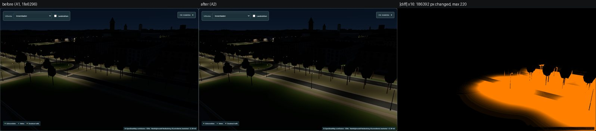
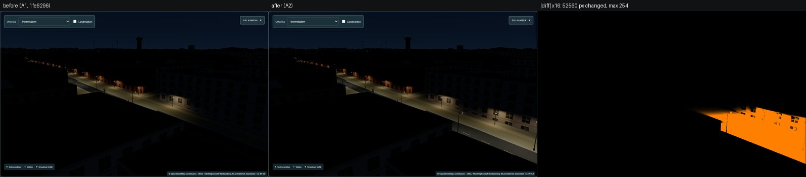
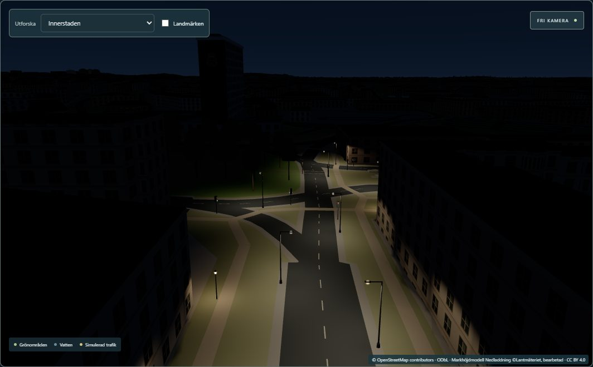
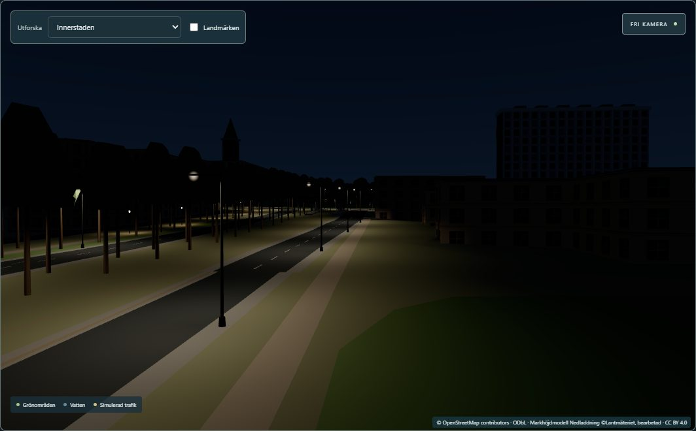

# Phase A2 — visual validation

**Method.** `scripts/lighting-phase0/capture.mjs` (unchanged; `POSES`/`STATES`/`ONLY`) against DEV
servers of the **committed A1 state** (`git archive 1fe6296` under ignored `work/lighting-a2/a1-app`,
port 5201) and this working tree (A2, port 5202). Edge 156 / ANGLE D3D11 / RTX 5070 Ti, 1400 × 1000,
DPR 1, Europe/Stockholm, 2026-10-21, day 12:39 / twilight 17:52 / night 21:30, stadium off, labels
off, API aborted (no traffic). Twelve poses ([`scripts/lighting-a2/poses.json`](../../scripts/lighting-a2/poses.json)
+ reference views) × 3 states = 36 images per build; each build captured twice (noise floor).
Comparison: `scripts/lighting-phase0/diff.py`, 8-bit RGB, **no tolerance**.

| Pose | Purpose |
|---|---|
| `a2-norra-promenaden-west-street`, `…-elevated` | western Norra Promenaden (zone D) |
| `a2-kungsgatan-north-street`, `…-elevated` | northern Kungsgatan (zone E) |
| `a2-a1-junction` | the A1 → A2 seam on Norra Promenaden |
| `a2-pilot-junction` | the A2 → Kungsgatan pilot seam |
| `a2-kungstorget-junction` | Kungsgatan into the Kungstorget east junction (D/E seam) |
| `a2-central-overview` | elevated corridor overview (A1, A2, pilot) |
| `a1-drottninggatan-elevated` | original A1 view |
| `kungsgatan-street`, `stromparken-elevated`, `pilot-overview` | original pilot views |

(The first Kungstorget pose stood inside the corner building and showed nothing; it was moved over
the Kungsgatan carriageway and re-captured for both builds and both passes before any comparison.)

## Noise floor

| Pair | Identical | Differences |
|---|---:|---|
| A1 state vs A1 state (second run) | 35 / 36 | `stromparken-elevated-day`: 12 px at 1 level |
| A2 vs A2 (second run) | 36 / 36 | — |

## A1 state → A2 (no tolerance)

| Pose | Day: changed px (max) | Twilight | Night | Where |
|---|---:|---:|---:|---|
| a2-kungsgatan-north-street | 5 352 (170) | 409 882 | 408 226 (58 % of the frame) | the newly lit street |
| a2-norra-promenaden-west-street | 2 530 (144) | 309 543 | 310 092 (44 %) | the newly lit street |
| a2-a1-junction | 681 (125) | 177 405 | 186 392 (27 %) | right half: A2 continues A1 |
| a2-kungstorget-junction | 1 491 (106) | 167 085 | 166 583 (24 %) | Kungsgatan and the junction |
| a2-norra-promenaden-west-elevated | 793 (136) | 121 411 | 122 445 (17 %) | |
| a2-kungsgatan-north-elevated | 864 (115) | 64 760 | 65 085 (9 %) | |
| a2-pilot-junction | 750 (145) | 52 687 | 52 560 (7.5 %) | right side: A2 continues the pilot |
| a2-central-overview | 157 (58) | 10 609 | 10 625 (1.5 %) | the corridor west of A1 |
| **a1-drottninggatan-elevated** (A1) | 8 (55) | 228 | 236 (0.03 %) | only the far left edge: A2 lamps on the horizon |
| **kungsgatan-street** (pilot) | 279 (89) | 1 296 | 1 264 (0.18 %) | only a 100 × 27 px box on the horizon (A2 lamps beyond the pilot) |
| **pilot-overview** | 0 | 1 868 | 1 867 (0.27 %) | only a 113 × 61 px box at the top (A2 in the distance) |
| **stromparken-elevated** (pilot) | 12 (1) = noise | 0 | 0 | identical |

Daytime differences are the new pole housings and lenses (real geometry); no daytime lighting
change. Reference views change **only where A2 itself becomes visible in the distance**; the pilot's
and A1's own pixels are unchanged (bounding boxes above; the E2E test adds a byte-identical check of a
view facing away from A2). Programs: **20 in all 72 compared captures**; exposure and the artificial
light level are identical in every pair (no global exposure change).

## Seams

| A1 → A2 (Norra Promenaden) | A2 → pilot (Kungsgatan) |
|---|---|
|  |  |

*Triptychs: before (A1 state) | after (A2) | |difference| × 16, half resolution.*

Both seams are continuous: the light pools of the two rollouts overlap at the boundary as they do
within a rollout, with no dark band, no doubled row and no bright spot. Measured on the carriageway
centreline with the CPU reference of the shader ([data/seams.json](data/seams.json)):

| Section | Min lux | Median | Max | Compare |
|---|---:|---:|---:|---|
| Kungsgatan within ± 20 m of the pilot seam | **10.0** | 18.2 | 22.9 | inside the pilot: min 7.4, median 16.7, max 22.7 |
| Norra Promenaden within ± 20 m of the A1 seam | **5.3** | 12.5 | 21.1 | inside A1 zone A: min 5.3, median 13.6, max 20.9 |
| A2 `lit=yes` carriageways (all) | 2.7 | 17.2 | 25.7 | before A2: 205 of 212 samples < 0.5 lux |
| Untagged Norrtull pieces | 0 | 0.1 | 10.4 | evidence gap ([remaining-gaps.md](remaining-gaps.md)) |

Junctions are not over-brightened: area maxima (1 m grid of ground illuminance) zone D 28.8 lux,
zone E 30.1 lux vs A1 zone A 30.6 lux and zone B 33.7 lux; the pilot box statistics are unchanged
(p50 0 / p95 12.3 / p99 20.1 / max 26.8 lux before and after).

## Newly lit areas (after, night)

Asphalt, pavements, the promenade path, facades and the junction are lit by the existing shader
lighting (not by glowing geometry): brackets on both kerbs of Kungsgatan with arms over the
carriageway, lanterns on the promenade path, the Slottsgatan junction mouth.

Outer-kerb brackets on both Norra Promenaden carriageways, tram reservation between them; toward
Kungstorget the untagged westbound piece (way 286445696/300186798) stays dimmer.

More: [evidence/night/](evidence/night/) (all A2 poses at night, Kungsgatan elevated by day/twilight/
night) and [evidence/visual/](evidence/visual/) (before | after | difference for 14 captures,
including the unchanged reference views).

## Checks against the requested failure modes

| Risk | Evidence |
|---|---|
| Duplicate streetlamps | none: IDs disjoint, ≥ 3 m from any earlier fixture and ≥ 0.55 × class spacing (16.5 m for 8 m brackets) from earlier same-class estimates (tested); maps and captures show single rows |
| Abrupt discontinuities / dark seams | seam minima above, both ≥ the minimum inside the neighbouring rollout |
| Over-brightened junctions | area maxima within the A1 range |
| Incorrect pole orientations | every bracket arm points to its own carriageway (heading from the kerb normal; corridor map ticks; captures) |
| Incorrect mounting heights | emitter = type lens height above the rendered ground for all 35 (tested) |
| Flickering halos / camera-dependent disappearance | A2 captures identical between two runs; LOD test: no fixture within the detail distance hidden from 300 cameras around A2 and both seams (> 10 000 checks); E2E frames byte-identical after swaps, recreation and context restoration |
