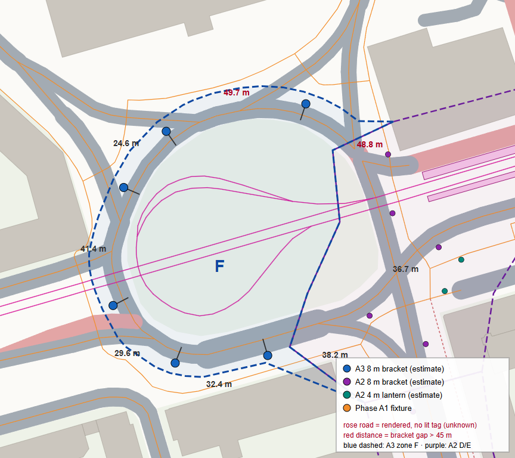

# Phase A3 — coverage: the Kungstorget ring

Coordinates are SWEREF 99 TM / EPSG:3006 E/N metres (the canonical boundary, `src/lib/lighting/corridorA3.ts`).
Scene coordinates are derived with the fixed affine reference of the rendered map (origin E 569 030,
N 6 494 989; x = east, z = south; 1 scene unit = 25 m; heights from the rendered terrain, no RH2000 value
is stored). Machine-readable: [`data/coverage.json`](data/coverage.json).

*Top-down map from committed data only (`scripts/lighting-a3/corridor-map.mjs`). Blue dashed: zone F;
purple dashed: A2 zones D/E. Large blue dots: the 6 A3 brackets (tick = arm); small purple/teal: A2.
Numbers: straight-line distance between consecutive ring brackets (red when > 45 m). The magenta lines
inside the island are the tram turning loop.*

## How the boundary was derived

1. **The ring** in the pinned Step 6.2 snapshot: nine `highway=secondary`, `junction=circular`,
   `name=Kungstorget`, `lit=yes` ways (285.1 m) plus one rendered 4.9 m piece without a `lit` tag
   (300027227, inside A2 zone D). A2 already lights the east arc (286445685, 286445687).
2. **Left for A3:** the seven other ring ways, 210.7 m (the A2 README's "≈ 250 m" was a rough
   planning estimate):

   | Way | Length | Part of the ring |
   |---|---:|---|
   | 312490062 | 44.3 m | north arc (from the Ingelstagatan / Norra Promenaden corner) |
   | 312486752 | 14.5 m | north-west |
   | 286445688 | 45.7 m | west arc (Stockholmsvägen side) |
   | 684962393 | 10.7 m | west link (Norra Promenaden west exit) |
   | 163928046 | 35.6 m | south-west arc |
   | 308315550 | 19.8 m | south |
   | 286445686 | 40.1 m | south arc (to the Kungsgatan link) |

3. **Outer edge:** every vertex of those seven ways in travel order, moved **8 m radially outwards** from
   the ring centre (mean of all vertices of the nine ring ways, E 568 321.7, N 6 495 541.1), rounded to
   0.1 m; vertices that would fall inside zone D are dropped. 8 m clears the outermost possible bracket
   (half the 6.6 m carriageway + 0.8 m kerb setback + at most 2 m extra setback = 6.1 m) and keeps every
   station of the approach streets outside (tested: 0 candidates from them).
4. **East edge:** zone D's west edge (A2 vertices 4–9) **reused exactly** (tested for equality), so the
   A2/A3 seam has no gap and no overlap.
5. Inside: the west part of the ring island (lawn, trees and the tram turning loop; no lit way gets a
   station there).

## Zone F (7 130 m², 39 vertices, 6 fixtures)

| Vertex | E | N | Feature |
|---|---:|---:|---|
| 1 | 568 377.7 | 6 495 581.3 | **A2 zone D vertex 4** (D's north-west corner) |
| 2–8 | 568 365.5 … 568 324.4 | 6 495 581.5 … 6 495 593.1 | 8 m outside the north arc 312490062 |
| 9–10 | 568 314.9 / 568 307.8 | 6 495 591.3 / 6 495 588.8 | outside 312486752 |
| 11–16 | 568 304.2 … 568 274.4 | 6 495 587.1 … 6 495 547.4 | outside the west arc 286445688 |
| 17–19 | 568 273.3 … 568 271.4 | 6 495 543.8 … 6 495 535.1 | outside 684962393 |
| 20–29 | 568 271.4 … 568 289.4 | 6 495 532.2 … 6 495 499.1 | outside 163928046 |
| 30–33 | 568 294.4 … 568 311.1 | 6 495 495.7 … 6 495 492.1 | outside 308315550 |
| 34 | 568 333.1 | 6 495 497.1 | outside 286445686 (its last two offset vertices lie in D) |
| 35–39 | 568 367.7 … 568 356.5 | 6 495 483.1 … 6 495 571.3 | **A2 zone D vertices 9, 8, 7, 6, 5** (D's west edge, reversed) |

The full vertex list is in `corridorA3.ts` and `data/coverage.json`; `corridorA3.test.ts` re-derives
vertices 2–34 from the committed extract and asserts they are equal.

### Seams and ownership

- **No overlap** with A2 (D, E), A1 or a pilot area: no edge crossings; every 1 m grid sample inside F
  belongs to F only (tested); no earlier fixture lies in F, and every A3 fixture lies in F.
- A2 → A3: the seam is D's west edge. It crosses the ring twice: on the north arc (312490062, near its
  start) and on the south arc (286445686, near its end).
- Light is not owned: A3 lamps light receivers in zone D, and A2 lamps light the A3 ring, through the
  global index (tested: indexed lookup = brute force).

## What is lit, what is not (inside zone F)

| Evidence | Ways | Length inside F | Result |
|---|---|---:|---|
| `lit=yes`, ring (`junction=circular`) | 7 ways above | 208.5 m (286445686 ends in D) | **6 × 8 m brackets** on the outer kerb (`lit-way-roundabout-outer`); 312486752 and 684962393 are shorter than half the 30 m class spacing → no station of their own (existing rule) |
| `lit=yes`, approach mouths | Stockholmsvägen 8174527, 287528316; Norra Promenaden 4438351, 287527545; Ingelstagatan 92385203, 92385206 | 67.6 m | none — their stations lie outside F (the approaches are out of scope) |
| no `lit` tag | Norra Promenaden 287527541 (rendered piece at the south-west mouth) | 7.9 m | none (unknown) |
| `lit=no` | — | 0 m | — |

No mapped OSM street lamp exists in or near F (0 nodes in the A3 extract).

Not in A3: the approach streets beyond their mouths (Stockholmsvägen, Norra Promenaden west, Ingelstagatan),
the ring piece 300027227 (untagged, in zone D), the Norrtull pieces (see [remaining-gaps.md](remaining-gaps.md)),
Phase B (Rådhuset), anything else.
