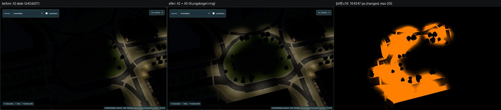
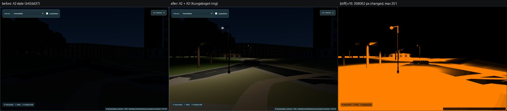

# Phase A3 — visual validation

**Method.** Paired captures in the running app (DEV builds; `scripts/lighting-phase0/capture.mjs`):
headless Edge, 1400 × 1000, DPR 1, Europe/Stockholm, 2026-10-21, traffic API aborted, labels off;
day 12:39, twilight 17:52, night 21:30, stadium off. **Before** = the committed A2 state (`b42dd37`,
served from `work/lighting-a3/a2-app` on port 5206), **after** = this working tree (port 5207). 14 views
× 3 states. Poses: [`data/capture-poses.json`](data/capture-poses.json) (A3 poses in
`scripts/lighting-a3/poses.json`). Pixel comparison without tolerance (`scripts/lighting-phase0/diff.py`):
[`data/visual-diff.json`](data/visual-diff.json).

**Noise floor.** A second (and, for twilight, a third) independent capture pass of the A3 build is
pixel-identical to the first in 41 of 42 images; the remaining one differs in 12 pixels by 1 level
(Strömparken, day) — [`data/noise-floor.json`](data/noise-floor.json). *Incident:* in the second pass six
twilight captures were taken before the map had finished loading, because a production build was running
on the machine at the same time (their metadata show `mapReadyMs: null`); they were excluded and the
twilight pass was repeated on an otherwise quiet machine (all 14 identical). The before/after pair used
below was fully loaded (all 84 captures `mapReady`).

## Before → after

| View | Day changed px (max) | Twilight changed px (max) | Night changed px (max) |
|---|---:|---:|---:|
| a3-ring-north-street | 2 731 (0.39 %, 169) | 357 258 (50.87 %, 193) | 358 062 (50.99 %, 251) |
| a3-ring-west-street | 700 (0.10 %, 163) | 392 690 (55.92 %, 184) | 389 749 (55.50 %, 207) |
| a3-ring-south-street | 2 300 (0.33 %, 165) | 375 402 (53.46 %, 185) | 371 707 (52.93 %, 248) |
| a3-ring-overhead | 251 (0.04 %, 107) | 168 167 (23.95 %, 185) | 164 347 (23.40 %, 205) |
| a3-ring-elevated | 171 (0.02 %, 92) | 44 921 (6.40 %, 187) | 44 616 (6.35 %, 193) |
| a3-a2-seam-north | 412 (0.06 %, 143) | 196 220 (27.94 %, 178) | 192 790 (27.45 %, 194) |
| a3-stockholmsvagen-approach | 596 (0.08 %, 127) | 26 309 (3.75 %, 203) | 26 563 (3.78 %, 208) |
| a3-central-overview | 25 (0.00 %, 35) | 4 774 (0.68 %, 214) | 4 744 (0.68 %, 239) |
| a2-kungstorget-junction | 20 (0.00 %, 61) | 8 272 (1.18 %, 172) | 8 473 (1.21 %, 191) |
| a2-kungsgatan-north-elevated | 17 (0.00 %, 63) | 1 704 (0.24 %, 159) | 1 757 (0.25 %, 172) |
| a2-norra-promenaden-west-street (Norrtull) | 5 (0.00 %, 29) | 961 (0.14 %, 70) | 959 (0.14 %, 101) |
| kungsgatan-street (pilot) | 13 (0.00 %, 34) | 192 (0.03 %, 68) | 194 (0.03 %, 100) |
| pilot-overview | 0 | 600 (0.09 %, 211) | 597 (0.09 %, 240) |
| stromparken-elevated (reference) | 0 | 0 | 0 |

Reading the table:

- **The ring lights up at twilight and night** (24–56 % of the frame in the ring views); by day only
  the six new poles change (≤ 0.4 %).
- **Earlier rollouts' views change only where A3 appears in the distance**: the Norrtull view changes in
  a thin strip on the horizon (the ring lamps far away), not on the Norrtull street itself; the pilot
  and A2 views likewise. Strömparken (facing away) is byte-identical in all states.
- **No global change:** exposure, programs (20) and draw calls are identical before and after in every
  view (capture metadata); triangles +12 … +552 per view (the six housings and halos in the shared
  chunk group).

*Ring from above at night: before (A2 state) | after (A2 + A3) | difference ×16. Before, only the
A2 east arc (right) is lit; after, the whole ring. The north arc (top left) stays the dimmest part.*

*North arc at street level: dark before, lit after (bracket `312490062:s0` in front).*

More pairs: [south street](evidence/visual/a3-ring-south-street-night.jpg),
[west street](evidence/visual/a3-ring-west-street-night.jpg),
[A2 seam (north)](evidence/visual/a3-a2-seam-north-night.jpg),
[Stockholmsvägen approach](evidence/visual/a3-stockholmsvagen-approach-night.jpg),
[central overview](evidence/visual/a3-central-overview-night.jpg),
[Norrtull view](evidence/visual/a2-norra-promenaden-west-street-night.jpg),
[Strömparken reference](evidence/visual/stromparken-elevated-night.jpg),
[overhead twilight](evidence/visual/a3-ring-overhead-twilight.jpg),
[overhead day](evidence/visual/a3-ring-overhead-day.jpg). Single after-images: [`evidence/night/`](evidence/night/).

## Illuminance on the road surface

CPU reference of the shader (`reference.ts`), horizontal illuminance on the rendered ground, before =
A2 state, after = with A3; 2.5 m steps along the ring centreline in travel order
([`data/ring.json`](data/ring.json)). Not a photometric survey (type-table photometry).

| Where | Samples | Before: median / min | After: median / min | After: samples < 1 lux |
|---|---:|---|---|---:|
| A3 part of the ring (zone F) | 95 | 0 / 0 lux (92 < 1 lux) | **11.4 / 0.5 lux** | 3 |
| A2 part of the ring (zone D) | 44 | 12.9 / 0.3 lux | 12.9 / **3.3** lux | 0 |
| Within ± 20 m of both A2/A3 seam crossings | 38 | — | 12.3 / **3.3** lux | 0 |
| Norrtull untagged pieces | 43 | 0.1 / 0 lux | **identical** | 30 (unchanged) |
| Approaches, first 30 m from the ring (6 ways) | 13–15 each | 0–0.3 lux median | 1.4–9.0 lux median (spill only) | — |

Area statistics (1 m grid inside the zone): zone F median 2.1 lux (lawn of the island included), p95
17.9, max 22.7 (before: max 5.6); A2 zone D unchanged at the reported resolution (p50 5.6, p95 19.2,
max 29.3) — A3 does not over-brighten the A2 junction.

- **Seam continuity:** the A2 arc was 0.3 lux at its lowest before A3 (its west end ran into the dark
  half); with A3 every sample at and across both seam crossings is ≥ 3.3 lux.
- **Dim stretches (documented, not hidden):** the darkest A3 samples (0.5 lux, ≈ 15 m below 3 lux) lie
  on the north arc between `312490062:s0` and `286445688:s0` (49.7 m apart), and 2.4–2.9 lux over ≈ 5 m
  at the west link 684962393. Both follow from the existing per-way station rule (short ways get no
  station); see [remaining-gaps.md](remaining-gaps.md#2-the-ring-has-two-dim-stretches-by-the-existing-station-rule).
