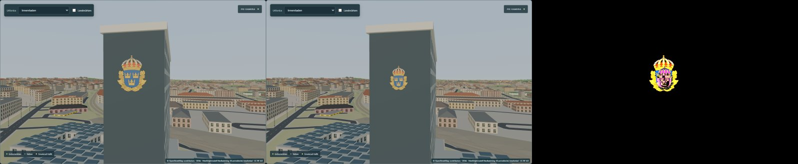
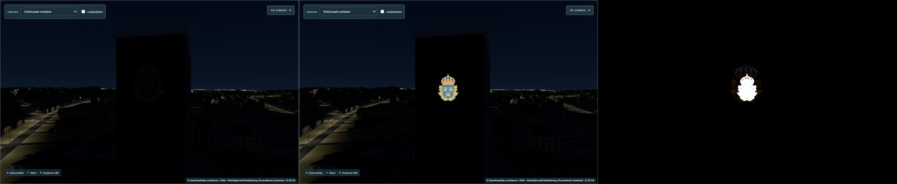
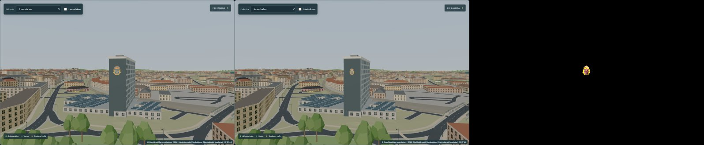
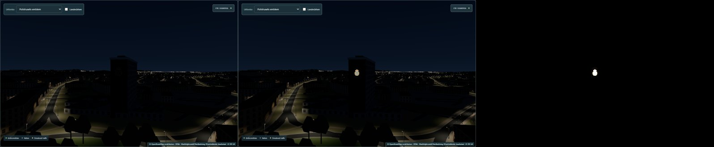
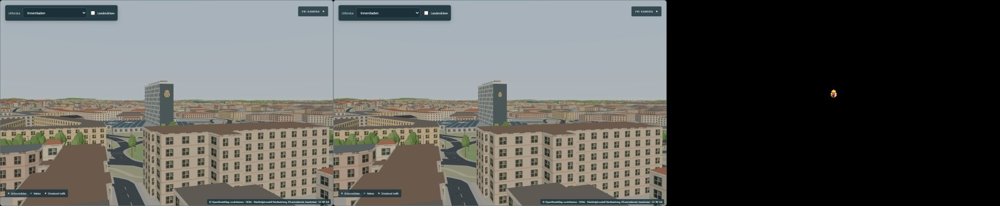
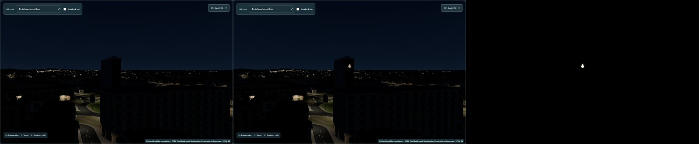
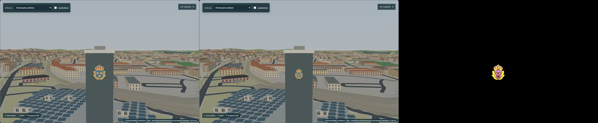
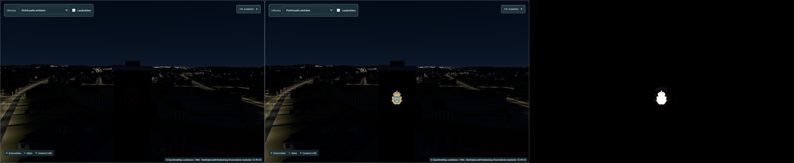
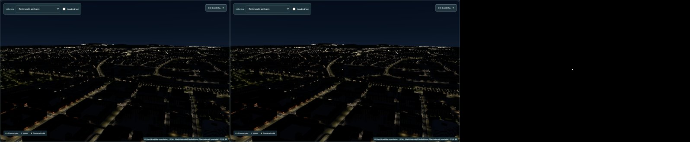
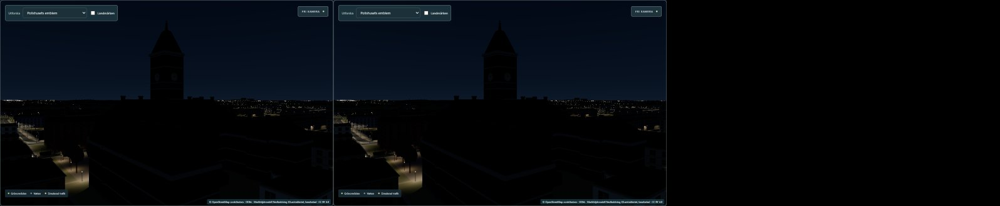

# Police Signs Phase D1 — the police emblem on Polishuset

Roadmap track D, step D1 ([roadmap](../roadmap.md) §4). Branch `claude/police-signs-d1` from `main`
= `8c5e437`. Approved by the user on 2026-10-25; **committed and pushed to `origin/claude/police-signs-d1`, not merged into `main`.**

## Verdict

The police station's one documented sign — the Swedish police emblem high on the tower's
south-south-east gable, facing Stockholmsvägen — is now drawn at its photographed size (3.75 × 4.96 m)
and position (centred, 10.9 m below the parapet), shows its own colours by day and glows at night
with the street lighting's night level. It adds no light source and no shader program (20 before and
after), costs −1 draw call and +411 triangles, and leaves every other part of the city
pixel-identical. Recommendation: **approve**; the night glow itself is an estimate (no night photo
found), and the tower it hangs on is the older illustrative model, ≈ 11 m too tall (follow-up).

## Which building, which sign

- **Stinsen 1 = Norrköpings polisstation, Stockholmsvägen 4–6** (Hemsö's property page), i.e. the
  police tower already in the model (OSM `relation/1356564`). What moved on 2026-01-26 was the
  police **reception**, to Luntgatan 32 (Polisen, 2026-01-19); the station stays. D1 is the tower.
- Photographs (Hemsö 2023, Commons 2008 / 2016 / 2018) all show **one** sign: the police emblem
  (crown, blue shield with three crowns, gold wreath), centred near the top of the SSE gable. No
  "POLIS" lettering on the tower or at the entrance; the NNW gable was never photographed (unknown,
  nothing placed). Details: [data-provenance.md](data-provenance.md).

## What changed

| Before (`main`) | After (D1) |
|---|---|
| Badge 6.25 × 7.5 m (model dimensions, not measured) at 1.1 m in front of the gable, transparent double-sided rectangle drawn in 2 passes | Emblem 3.75 × 4.96 m, centred, 10.9 m below the parapet, 0.25 m in front of the wall: an **opaque emblem-shaped surface** (outline traced from the artwork) |
| Dark at night (lit only by the sky/ambient) | Self-lit: artwork as colour **and** emissive map, emissive gain 1.1 × `env.artificial` (0 by day). No three.js light, no façade spill |
| Program variant of the alpha-tested trees/signs | Shares the existing program of the tram/bus destination signs (opaque, front-sided, instanced, map + emissiveMap) — 20 programs, unchanged |

Measured values (LiDAR, Lantmäteriet 2020): tower 54.4 × 13.4 m, parapet ≈ 49.5 m RH2000, ground in
front of the gable 11.84 m → ≈ 37.7 m tall, long axis 165.6°. Sign size and height = photo ratios ×
the LiDAR gable width. On the real building the emblem's centre is ≈ 38.6 m RH2000 (≈ 26.8 m above
the street). Because the drawn tower is ≈ 11 m taller, the sign keeps its real size and real distance
below the parapet ([remaining-gaps.md](remaining-gaps.md) §3).

## Evidence (before | after | difference × 4)

| | |
|---|---|
|  close, day |  close, night |
|  gable, day |  gable, night |
|  from Stockholmsvägen, day |  from Stockholmsvägen, night |
|  app preset "Polishusets emblem", day |  preset, night |
|  district (700 m), night |  control: Rådhuset (0 px changed) |

Changed pixels per capture (1400 × 1000 panel, [compare-report.json](evidence/compare-report.json)):
close 11 418 day / 10 921 night; gable 1 231 / 1 043; Stockholmsvägen 446 / 342; preset 4 157 /
3 799; district 48 / 28; **controls (Rådhuset, Kungsgatan) 0 / 0**. Calls −1 and triangles +411 in
every view with the tower, 0 / 0 in the controls; programs 20 / 20 everywhere.

Captures: `node scripts/police-signs-d1/capture.mjs <out> <baseUrl>` (dev servers, API aborted),
comparison `scripts/vehicle-lights-f1/compare.mjs` (unchanged).

## Performance (gates: `docs/step62/rollout-plan.md`)

Method as F1/B1: production builds by `vite preview` (before = `main` exported to
`work/police-signs-d1/before-app`), uncapped Edge 156, 1280 × 900, DPR 1, fresh browser per run,
before/after alternating; traffic on via an isolated backend copy (port 8096), world reset and
paused; views Kungsgatan, Strömparken, Innerstaden and the police preset; day 12:39 and night 21:30.
Two series (3 + 5 rounds), pooled: [data/perf-pooled.json](data/perf-pooled.json). RTX 5070 Ti.

| Gate | Measured (median over 8 rounds) | ✔ |
|---|---|---|
| Day p95 Δ ≤ 0.5 ms | Kungsgatan +0.1, Strömparken +0.45, Innerstaden 0.0, police view +0.4 | ✔ |
| Night p95 Δ ≤ 1 ms | −0.1, +0.5, +0.05, 0.0 | ✔ |
| Map-ready Δ ≤ 100 ms | +39 ms (rounds −63 … +68) | ✔ |
| Heap Δ ≤ 10 MB | +0.13 MB | ✔ |
| Calls ≤ +40, triangles ≤ +100 k | −1, +411 | ✔ |
| No new programs, no realtime lights | 20 → 20 day and night; point/spot/shadow maps 0 | ✔ |

p95 = the 95th-percentile frame interval (the slow frames). The first series alone looked worse in
the police view (+0.8 day, +1.3 night) because of one noisy round where every view, including ones
without the tower, jumped by 1–5 ms; the five-round repeat gave +0.2 / −0.3. Strömparken (no police
tower in view) shows the same ±1.5 ms scatter as in B1. The cost of the sign is one opaque
400-vertex mesh replacing a two-pass transparent quad, so a real frame-time effect is not expected.
A shortened programme (two series, no separate stress run) is used because D1 adds one mesh and no
shader work.

## Checks

| Check | Result |
|---|---|
| `npm run check` | 0 errors, 0 warnings (1180 files) |
| `npm run build` | OK (same chunk-size warning as `main`) |
| `npm test` (Vitest) | 443 / 444. The one failure is `terrain.test.ts` › "ships identical elevation input in backend and UI": it reads `../norrkoping-simulator-backend/…` relative to the working folder, which does not exist from a git worktree. The same comparison run with the absolute path is deep-equal, and `src/lib/data` is unchanged. Not caused by D1 |
| `npm run test:e2e` (Playwright, dev server + isolated backend copy 8096) | **13 / 13** passed, including the new test and the usually flaky A2/A3, simulation and transit specs |
| New Vitest `src/lib/landmarks/police/police.test.ts` (9) | LiDAR values = spec; size/height from photo ratios (3.75 / 4.96 / 10.9 m), sign keeps the artwork's proportions, view angle < 15°; placement centred on the SSE gable, 0.25 m in front, below the parapet, within the gable; gable bearing within 3° of the LiDAR; night level 0 → no glow, 1 → 1.1, clamped; no light objects; opaque, front-sided, single-instance InstancedMesh (program-sharing contract); outline matches the current SVG (SHA-256), UVs inside the texture, area 55–90 % |
| New Playwright `tests/police-signs.spec.ts` | one `police-sign` on the tower group; no glow by day; at night luma (perceived brightness, 0–255) of the sign 137.8 vs the gable wall beside it 0.1 (needs > 40 more); realtime lights unchanged; 20 programs day and night; glow off again by day |
| Earlier phases unchanged | `git diff 8c5e437` touches only `.gitignore`, `DATA-LICENSE.md`, `Scene.svelte` (+2 lines), `mapView.ts` (+4), `mapLandmarks.ts` (badge → sign); `src/lib/data`, `src/lib/lighting`, `src/lib/landmarks/radhuset`, `transportModels.ts`, `publicTransport.ts`, `public/`, all earlier `docs/*` and their tests are unchanged; L2/L2bc data SHA-256 equal to `main` |
| Reproducibility | `police_tower_lidar.py` rebuilt byte-identically (SHA-256 `8b836ff5…db0ec2`; Python 3.12.14, numpy 2.3.5, laspy 2.7.0); `emblem-outline.mjs` rebuilt byte-identically (`a826f3fb…4838d1`, Edge 156.0.4314.42) |

## Files

| File | |
|---|---|
| `src/lib/landmarks/police/spec.ts` | measured / derived / estimated values with source tags; `signPlacement()` |
| `src/lib/landmarks/police/sign.ts` | emblem-shaped geometry, material, `setNightLevel` |
| `src/lib/landmarks/police/emblem-outline.json` | derived outline (1 contour + 9 holes, 400 points) |
| `src/lib/landmarks/police/police.test.ts` | unit tests |
| `src/lib/mapLandmarks.ts` | badge replaced by the sign; tower position/rotation from `TOWER_MODEL` (same values) |
| `src/lib/mapView.ts`, `src/lib/Scene.svelte` | night level passed to the sign each frame (like F1's lens glow) |
| `tests/police-signs.spec.ts` | Playwright test |
| `scripts/police-signs-d1/` | `police_tower_lidar.py`, `emblem-outline.mjs`, `capture.mjs` |
| `docs/police-signs-d1/` | this README, [data-provenance.md](data-provenance.md), [police-signs-provenance.json](police-signs-provenance.json), [remaining-gaps.md](remaining-gaps.md), `data/`, `evidence/` |
| `DATA-LICENSE.md`, `.gitignore` | licence paragraph; `/work/police-signs-d1/` ignored |

Running the LiDAR script from a worktree: set `NKPG_WORK` to the main checkout's `work/` folder (read
only). Local only (not for Git): `.claude/launch.json` (`d1-*` entries, ports 8096, 5230–5233),
`work/police-signs-d1/` (baseline app, captures, perf runs, rebuild copies).
