# Police Tower Phase D1b — the police tower from LiDAR

Follow-up to [Police Signs D1](../police-signs-d1/README.md) ([its gap §3](../police-signs-d1/remaining-gaps.md)).
Branch `claude/funny-hawking-afb6cd`, brought up to date with `main` = `aaa9b3d` (D1 with its
follow-up: emblem scale corrected, lit windows). **Committed and pushed on this branch (user,
2026-10-25); `main` not fast-forwarded.**

## Verdict

The police tower is now drawn from Lantmäteriet's laser data instead of the earlier illustrative
box. It stands at the measured position and angle, its roof is at the measured height (parapet
49.35 m RH2000, 37.6 m above the street in front, 8.2 m lower than before), and it has the measured
shape: a ≈ 9 m wide slab with the dark emblem gable, a one-storey-lower strip along the east side
that stops 4.5 m short of the gable (the light recess in the photos), a lower north end, and the
rooftop plant with the 64 m mast. The emblem (with D1's corrected size) and the lit windows at
night moved onto the measured tower. Programs stay at 20, draw calls drop by 6, every performance
gate is met, and views elsewhere in the city are pixel-identical. Recommendation: **approve**.

## Decisions needed

None. (D1b's first finding, that the emblem was scaled to the wrong gable width, has been corrected
on `main` by the D1 follow-up with the user's approval; D1b takes the corrected values unchanged.)

## Risks / not verified

- The façade's window rhythm, the NNW gable's colour and the plant-box sizes are estimates; only
  roofs are measured (airborne LiDAR sees no walls) ([remaining-gaps.md](remaining-gaps.md)).
- The low wings around the tower are still the generic 7 m OSM block (not part of this phase).
- Three browser tests are known to be flaky and fail on `main` as often as here (A2/A3 picture
  checks, `simulation.spec.ts`; see Checks).

## What changed

| | Before (`main`, illustrative) | After (D1b, measured) |
|---|---|---|
| Position (centre) | scene (−29.25, −26.22) | scene (−29.0479, −25.8868): 9.7 m to the SSE/ENE |
| Long axis | bearing 164.1° (0.2775 rad) | 163.71° (0.284254 rad), the slab's own axis |
| Shape | one box 66.25 × 12.75 m, overhanging cap, six rooftop boxes | UPPER slab 50.6 × 9.06 m to 49.35 m; EAST strip (4.7 m wide) to 45.32 m with a 46.23 m rim, ending 4.5 m before the SSE gable; NORTH block to 46.26 m; 9 plant boxes and the mast to 64.12 m |
| Footprint | 66.25 × 12.75 m | 55.84 × 13.76 m (D1's whole-roof measurement: 54.38 × 13.42 m + edge) |
| Height | parapet 57.58 m RH2000 (47.6 m above the complex's lowest OSM ground; bottom 10.58 m) | parapet 49.35 m RH2000 (absolute, like Rådhuset); walls down to the rendered ground under the tower (12.18 m) |
| Emblem (D1's corrected `SIGN`, 2.51 × 3.32 m) | centre 7.3 m below the drawn parapet = 50.28 m RH2000 | 7.3 m below the measured parapet = 42.05 m RH2000 (30.3 m above the ground in front) |
| Lit windows (D1 follow-up) | on the slab's two long faces | on the measured façades: ENE-facing faces one pattern, WSW-facing the other; textures repeat at a fixed bay/storey size |
| Meshes / draw calls | slab InstancedMesh with 6 material groups, cap, 6 plant boxes (13 calls) + sign | façade InstancedMesh with 2 groups + 5 meshes (7 calls) + sign: −6 calls |
| Materials | colour; window map + emissive map, instanced | the same kinds, no new shader program |

Unchanged: D1's sign (`sign.ts`, `emblem-outline.json`, `SIGN`, `GABLE_WIDTH_M`, `NIGHT_GAIN`), the
window patterns (`windows.ts`), the low wings (OSM), the camera presets ("Polishusets emblem" still
frames the emblem: its target is 2 m from the new gable centre).

## Evidence (before | after | difference × 4), against `main` `aaa9b3d`

Captures in a fixed world frame from the LiDAR (`scripts/police-tower-d1b/capture.mjs`, dev
servers, API aborted, 1400 × 1000 panel), compared with `scripts/vehicle-lights-f1/compare.mjs`
(unchanged). Report: [evidence/after-sync/compare-report.json](evidence/after-sync/compare-report.json).

| Picture | View | Changed pixels | Calls | Triangles | Programs |
|---|---|---|---|---|---|
| 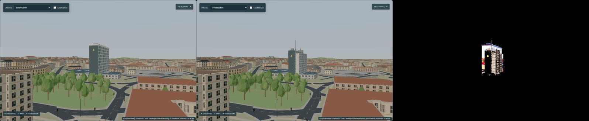 | about the Hemsö photo's direction: gable, light recess, ENE façade | 14 064 | 1862 → 1856 | +40 | 20 → 20 |
| 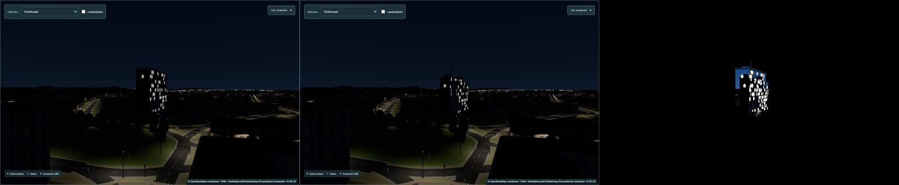 | the same at night: emblem and lit windows | 13 449 | 1863 → 1857 | +40 | 20 → 20 |
| 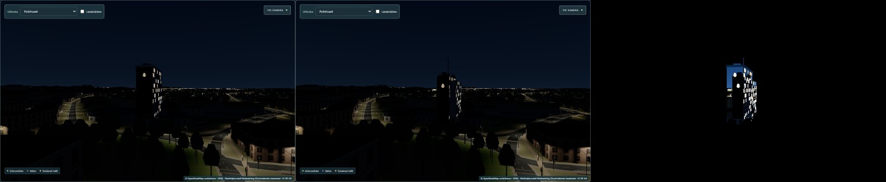 | the SSE gable from 150 m, night | 14 453 | 1731 → 1725 | +40 | 20 → 20 |
| 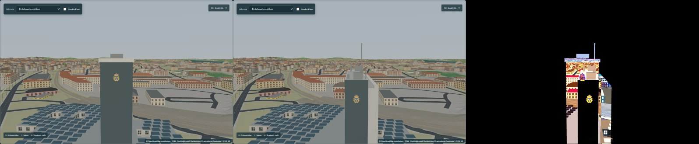 | app preset "Polishusets emblem", day | 53 483 | 1635 → 1629 | +40 | 20 → 20 |
| 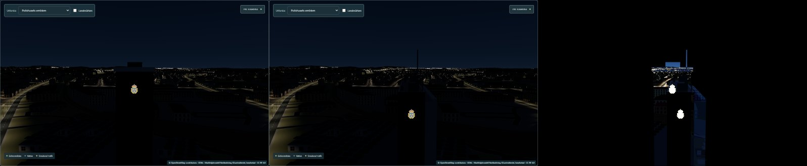 | preset, night | 47 074 | 1636 → 1630 | +40 | 20 → 20 |
| 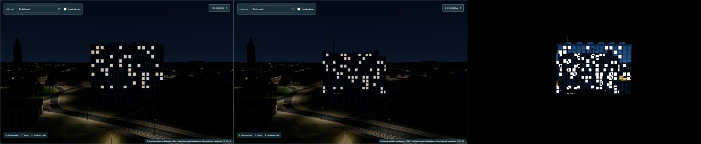 | from the ENE, night: windows on the measured façade | 70 423 | 1966 → 1960 | +40 | 20 → 20 |
| 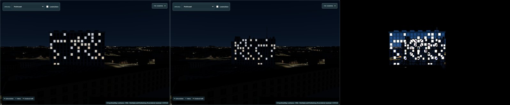 | from the WSW, night (north end lower, left) | 70 078 | 2277 → 2271 | +40 | 20 → 20 |
| 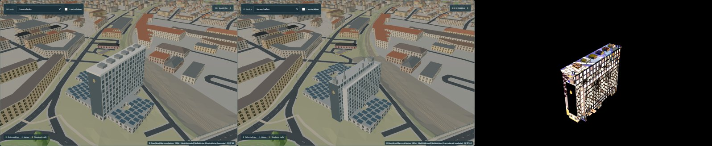 | the roof: three heights, plant, mast | 56 719 | 680 → 674 | +40 | 20 → 20 |
| 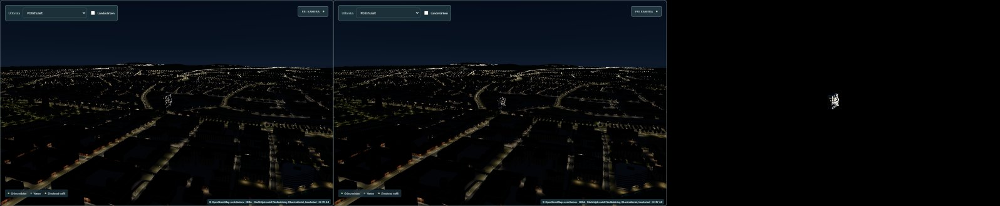 | district, 700 m | 1 306 | 2211 → 2205 | +40 | 20 → 20 |
| 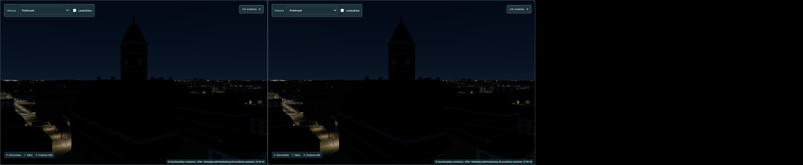 | control: Rådhuset | **0** | equal | 0 | 20 → 20 |
| 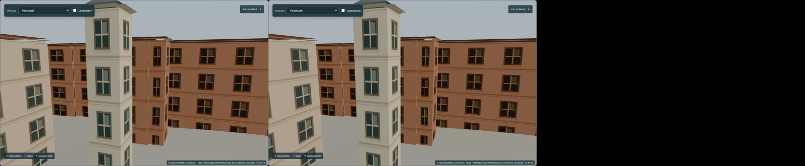 | control: Kungsgatan | **0** | equal | 0 | 20 → 20 |

All 24 captures (12 views × day/night) in the report: every view with the tower −6 calls, +40
triangles, 20 → 20 programs; both control views 0 changed pixels by day and at night.
The first round against `main` `d3d228c` (before the D1 follow-up) is kept in `evidence/` (13
pictures, same method).

## Performance (gates: `docs/step62/rollout-plan.md`)

Method as F1/B1/D1: production builds by `vite preview` (before = `main` `aaa9b3d` exported to
`work/police-tower-d1b/before-app-aaa9b3d`), uncapped Edge 156, 1280 × 900, DPR 1, fresh browser
per run, before/after alternating; traffic on via an isolated backend copy (port 8097), world reset
and paused; views Kungsgatan, Strömparken, Innerstaden, the "Polishusets emblem" and "Polishuset"
presets; day 12:39 and night 21:30. Two series (3 + 5 rounds), pooled:
[data/after-sync/perf-pooled.json](data/after-sync/perf-pooled.json). RTX 5070 Ti, quiet machine.
p95 = the 95th-percentile frame interval (the slow frames).

| Gate | Measured (median over 8 rounds) | ✔ |
|---|---|---|
| Day p95 Δ ≤ 0.5 ms | Kungsgatan −0.1, Strömparken −0.05, Innerstaden −0.05, emblem preset −0.2, Polishuset −0.05 | ✔ |
| Night p95 Δ ≤ 1 ms | +0.05, −0.25, −0.3, 0.0, 0.0 | ✔ |
| Map-ready Δ ≤ 100 ms | +1 ms (rounds 74, 14, −84, −13, 53, −16, 34, −13) | ✔ |
| Heap Δ ≤ 10 MB | +0.04 MB | ✔ |
| Calls ≤ +40, triangles ≤ +100 k | −6, +40 | ✔ |
| No new programs, no realtime lights | 20 → 20 day and night; point/spot lights 0 | ✔ |

Building all landmark details (`createLandmarkDetails()`, incl. the tower, its textures, the
window glow maps and the sign): 11.7 ms median before and after (30 runs each, dev builds;
[data/after-sync/landmark-build-cost.json](data/after-sync/landmark-build-cost.json)).

An earlier pair of series against `d3d228c` ([data/perf-pooled.json](data/perf-pooled.json)) ran
while another Vite dev server used ≈ 2.6 CPU cores: p95 within the gates but map-ready +203 ms
with rounds from −114 to +2 967 ms (noise). It is superseded by the quiet runs above.

## Checks

| Check | Result |
|---|---|
| `npm run check` | 0 errors, 0 warnings (1183 files) |
| `npm run build` | OK (same chunk-size warning as `main`) |
| `npm test` (Vitest, PowerShell) | 460 / 461. The one failure is `terrain.test.ts` › "ships identical elevation input in backend and UI": it reads `../norrkoping-simulator-backend/…` relative to the working folder, which does not exist from a git worktree (same as D1). The comparison with the absolute path is deep-equal; `src/lib/data` is unchanged |
| `npm run test:e2e` (Playwright, dev server + backend copy 8097) | 12 / 14. The two failures are known flaky tests. Alternating 3 runs each: A2 corridor picture check — branch 3 / 3 passed, `main` 1 / 3; `simulation.spec.ts` — branch 1 / 3, `main` 0 / 3. Earlier rounds also saw the A3 Kungstorget picture check fail on both (branch 2 / 6, `main` 3 / 6; one pixel ±1 in the Kungstorget ring, not on the tower). Not caused by D1b |
| D1's tests (to keep green) | `police.test.ts` and `tests/police-signs.spec.ts` pass, including the lit windows (night luma of the measured ENE façade 34.2, needs > 10), the sign (153.3 vs wall 0.1) and 20 programs |
| New Vitest `src/lib/landmarks/police/tower.test.ts` (14) | spec = LiDAR file; scene units and RH2000 origin = terrain reference; parts as in the photos (UPPER 8.5–9.5 m, one storey above the EAST strip, which ends 4–5 m before the gable); whole footprint vs D1 (length +0…1.5 m, width +0…0.5 m, centre < 0.5 m, height 37.6 m, axis < 2°); frame round trip and the gable centre; outline area = parts; heights (base, parapet 49.35, mast 64.12); nothing in the recess; normals outward, none downward; SSE gable faces +z; façade groups 0 = ENE, 1 = WSW; façade UVs; emblem on the UPPER gable at 42.05 m |
| New Playwright `tests/police-tower.spec.ts` | one `police-tower` group on the measured frame at height 0; six meshes; parapet 49.35 m, mast 64.12 m; walls reach the ground (within 1 m of 11.74 m; all wall meshes to the same base); emblem at 42.05 m within 0.75 m of the gable centre; 20 programs day and night; realtime lights unchanged; no page errors |
| D1 tests updated (not weakened) | `police.test.ts`: the slab constants now come from the measured tower; "sign behind the parapet cap's overhang" became "`TOWER_MODEL`'s gable is the drawn gable wall" (the flush parapet has no overhang). `police-signs.spec.ts`: the expected tower frame is the measured one (was −29.25, −26.22, 0.2775); the wall sample point is 3.2 m beside the sign centre (gable now 4.5 m half-wide, was 6.4 m); the façade sample point for the windows is on the measured ENE façade (c 9.23 m, 30 m RH2000; was the old slab's face 0.255 units from its axis). All assertions and thresholds unchanged |
| Earlier phases unchanged | `git diff aaa9b3d` touches only `.gitignore`, `DATA-LICENSE.md` (+1 paragraph), `mapLandmarks.ts` (police tower block), `landmarks/police/spec.ts` (new tower values, `TOWER_MODEL` derived), the two D1 tests and `docs/claude-progress.md`, `docs/roadmap.md`; `src/lib/data`, `public/`, `src/lib/lighting`, `src/lib/landmarks/radhuset`, `sign.ts`, `windows.ts`, `emblem-outline.json`, all earlier `docs/*` (incl. `docs/police-signs-d1/`) and `scripts/police-signs-d1/` are unchanged. Control views 0 changed pixels. Solar panels 127 → 125 (two the moved tower would cut through) |
| Reproducibility | `police_tower_parts.py` rebuilt byte-identically (SHA-256 `e85c3cdb…8e89a0d`; Python 3.12.14, numpy 2.3.5, laspy 2.7.0; same tile SHA-256 as D1) |

## Files

| File | |
|---|---|
| `src/lib/landmarks/police/spec.ts` | `TOWER`, `PLANT`, `DETAIL`, `EDGE_M`, `METRES_PER_UNIT` (LiDAR parts and estimates, with source tags); `TOWER_MODEL` now derived from them |
| `src/lib/landmarks/police/tower.ts` | geometry (6 surfaces; the façade with ENE/WSW groups), frame conversions, footprint outline, `nearTower` |
| `src/lib/landmarks/police/tower.test.ts` | new unit tests (14) |
| `src/lib/landmarks/police/police.test.ts`, `tests/police-signs.spec.ts` | D1 tests adapted to the measured tower (see Checks) |
| `src/lib/mapLandmarks.ts` | the illustrative slab replaced by the measured tower, with the lit-window materials; solar panels kept clear of it |
| `tests/police-tower.spec.ts` | new Playwright test |
| `scripts/police-tower-d1b/police_tower_parts.py` | LiDAR measurement of the tower's parts |
| `scripts/police-tower-d1b/capture.mjs` | before/after captures in a fixed world frame |
| `docs/police-tower-d1b/` | this README, [data-provenance.md](data-provenance.md), [police-tower-provenance.json](police-tower-provenance.json), [remaining-gaps.md](remaining-gaps.md), `data/`, `evidence/` |
| `DATA-LICENSE.md`, `.gitignore` | licence paragraph; `/work/police-tower-d1b/` ignored |

Local only (not for Git): `.claude/launch.json` (`d1b-*`: backend 8097, dev 5240/5241, preview
5242/5243), `work/police-tower-d1b/` (baseline apps, captures, perf runs, diagnostics, rebuild copy).
Running the LiDAR script from a worktree: set `NKPG_WORK` to the main checkout's `work/` folder.
