# Vehicle Lights Phase F2 — headlights and tail lights on trams and trains (2026-11-13)

Worked directly on local `main` (= `origin/main` `eee971c`). Backend unchanged. **Approved by the user on
2026-11-13 with the recommended decisions below; not committed yet.** Roadmap track F, step F2.

## Verdict

At night every simulated tram and train now shows lit white headlamps in front and red tail lamps
behind, and the ones nearest the camera throw a light pool on the track ahead, exactly like the
cars and buses have done since F1. By day nothing changes: the six day pictures are byte-identical
to `main`. Recommendation: **approve**. It is a small step that reuses tested code, the cost is not
measurable, and all checks pass.

## Decisions (the user chose the recommendations, 2026-11-13)

1. **A train's light pool is the same as a car's (60 m, wide).** A real train's headlamp reaches
   much further. *Recommended:* keep it for now. A special rail beam needs values from a source,
   and none is in the project.
2. **The lamps are the two-and-two the models already had** (two white in front, two red behind).
   Whether the real vehicles carry a third, upper headlamp was not looked up. *Recommended:* leave
   as is; redraw only if you want the models closer to the real vehicles (that changes the day
   picture too).
3. **No lit windows.** A tram or train at night is a dark body with lit lamps. *Recommended:* a
   separate small step for lit windows on trams, trains and buses together, if you want it.

## Risks / not verified

- **All light values are estimates**, taken over from F1 (strength, shape, reach, colour). No
  photometry (measured light data) of the real vehicles exists in the project.
- **Only looked at in the test browser** (Edge, on this machine). Not tried on a weaker computer.
- **Trams and trains share F1's limit of 16 light pools.** In heavy traffic a tram that is farther
  from the camera than 16 other vehicles shows lit lamps but no pool on the ground.
- **The white lamps always sit on the leading section.** The simulation always drives that section
  first (checked on all 8 trams and 2 trains: it is 6.4 m / 20.0 m ahead of the next one). If the
  backend ever reverses a vehicle, the lamps would be on the wrong end.
- One unit test fails, as before this phase: `police.test.ts` (a line-ending problem with an SVG
  file on Windows; not touched here).

## What changed

| Part | Where | What |
|---|---|---|
| Lenses | [`publicTransport.ts`](../../src/lib/publicTransport.ts) `setNightLevel` | The headlamp and tail-lamp materials shared by trams and trains get the same night glow as the buses' (F1). They are part of the instanced meshes, so every tram and train shows them. The geometry is unchanged. |
| Poses | `publicTransport.ts` `update` / `poses` | One pose per tram and train: its **leading section** (section 0, which carries the white lenses), with heading and pitch. Before, only buses reported a pose. |
| Beam | [`vehicleLights.ts`](../../src/lib/lighting/vehicleLights.ts) | `tram` and `train` join the lamp table (lens front 3.145 m / 9.835 m ahead of the leading section's centre, 0.84 m up, read from the drawn models). The lamp follows the section's pitch on a gradient; the beam stays horizontal. Selection, shader and uniforms are F1's, untouched. |

No new meshes, materials, lights or shader programs. The lighting shader (`cityLights.ts`), the
controller and `Scene.svelte` are unchanged: they already pass every reported pose to the beam
selection.

## Pictures

The simulation was reset and paused, so `main` and F2 show the same frozen vehicles (same poses in
both `shots.json`). Tram 10001 on line 2, train 10009.

| | `main` | F2 |
|---|---|---|
| Tram, front, night | 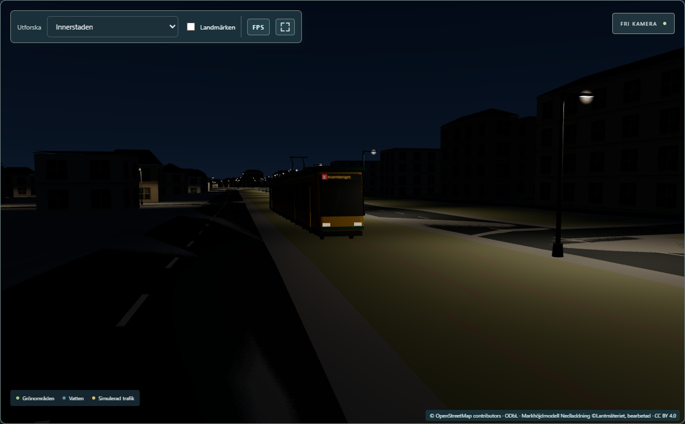 | 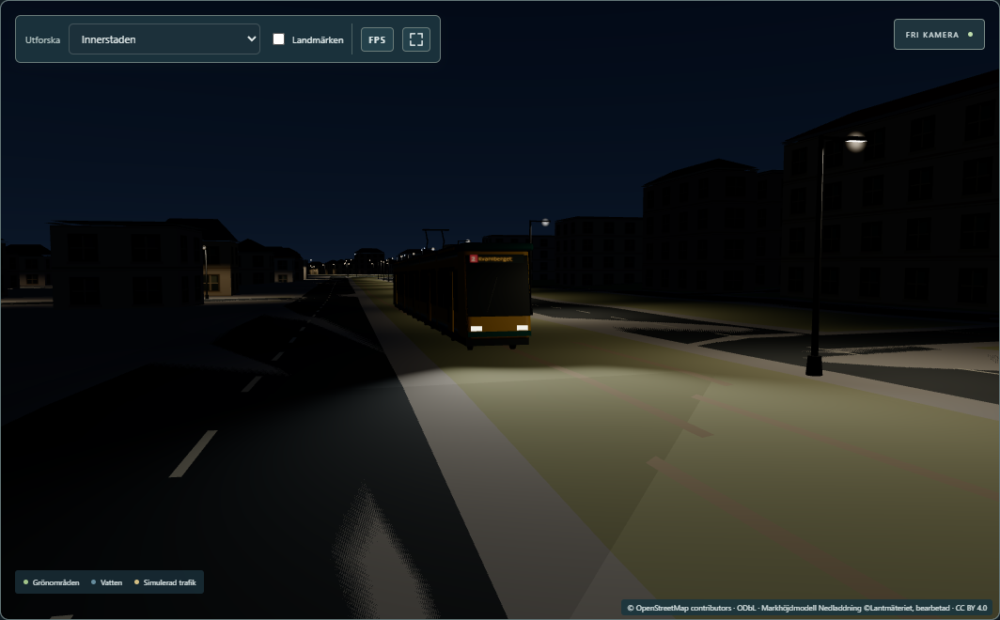 |
| Tram, rear, night | 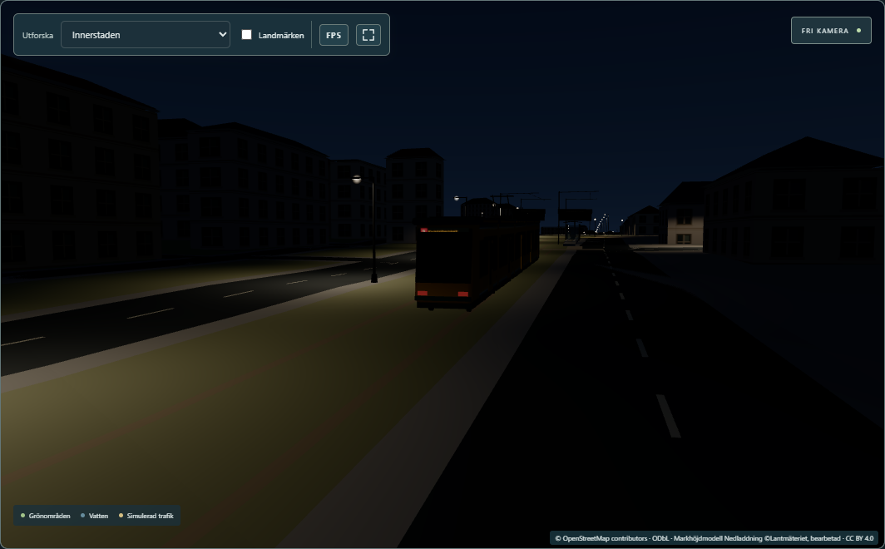 | 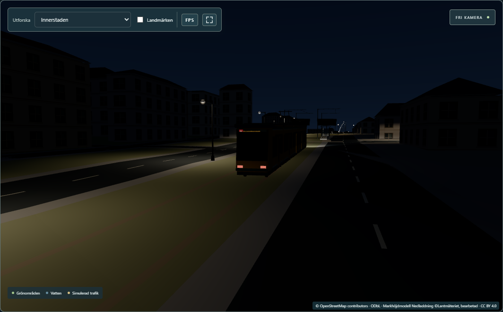 |
| Tram, from above, night | 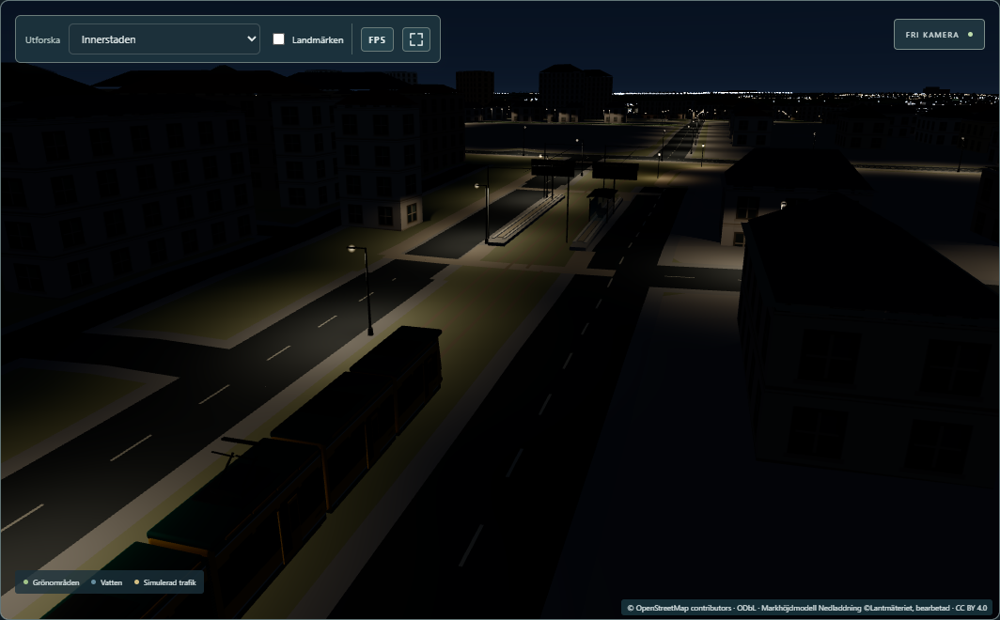 | 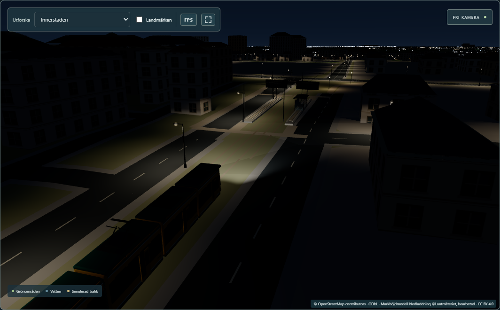 |
| Train, front, night | 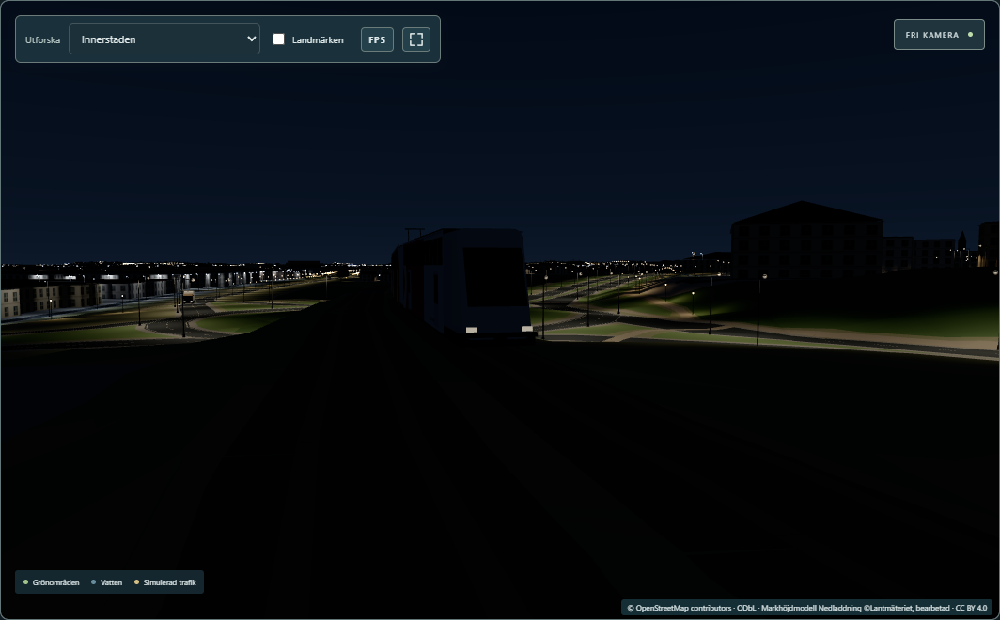 | 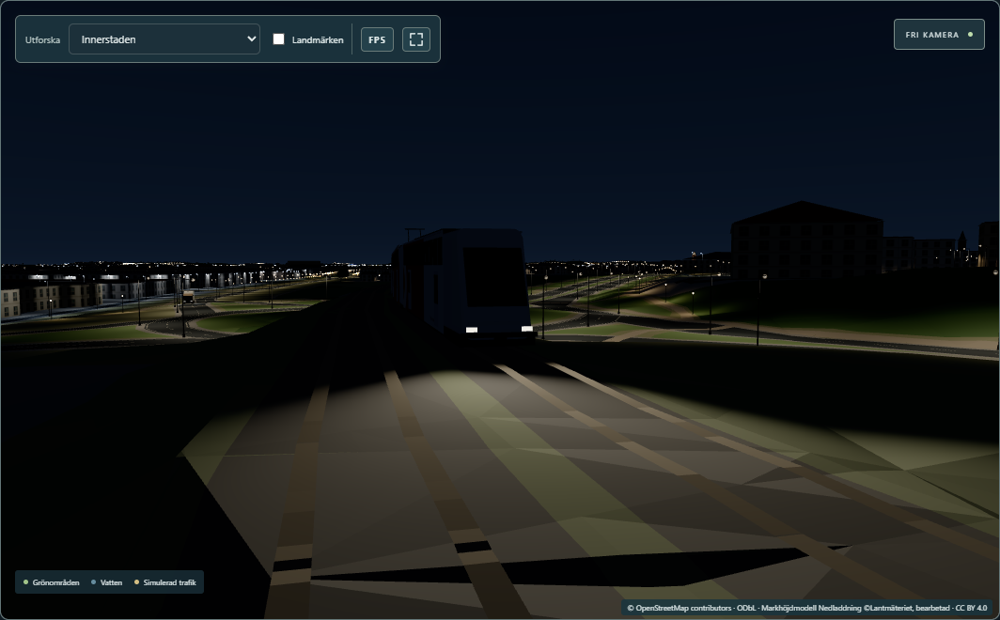 |
| Train, rear, night |  | 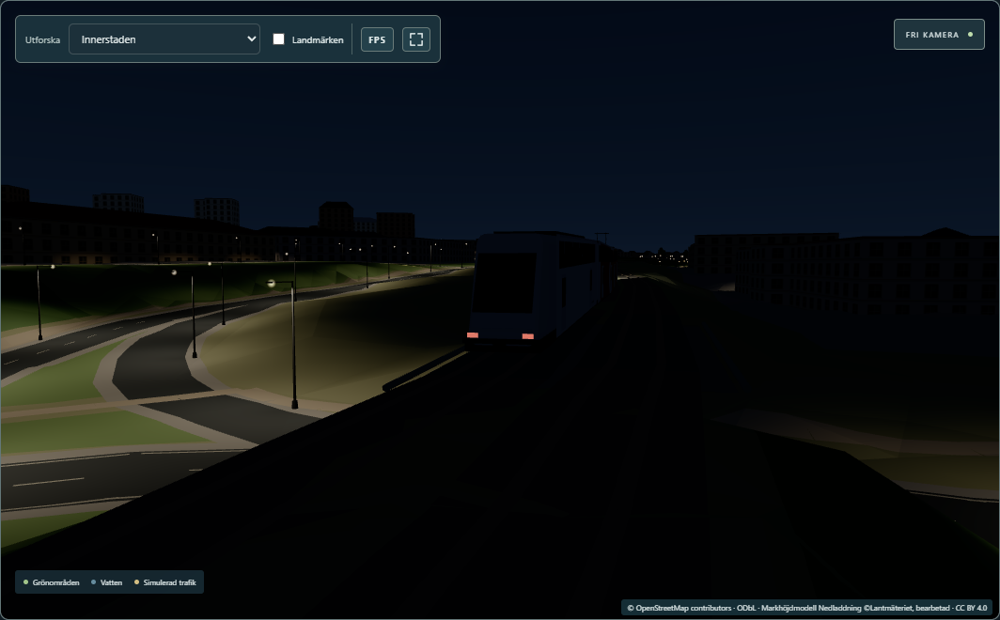 |
| Train, from above, night | 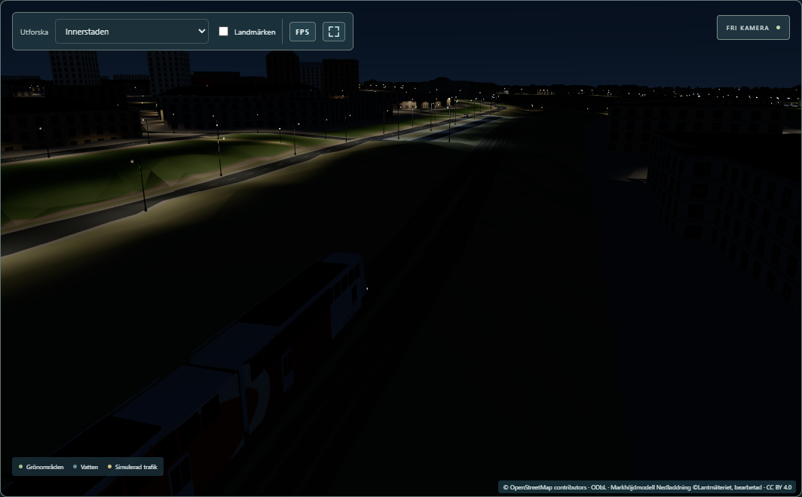 | 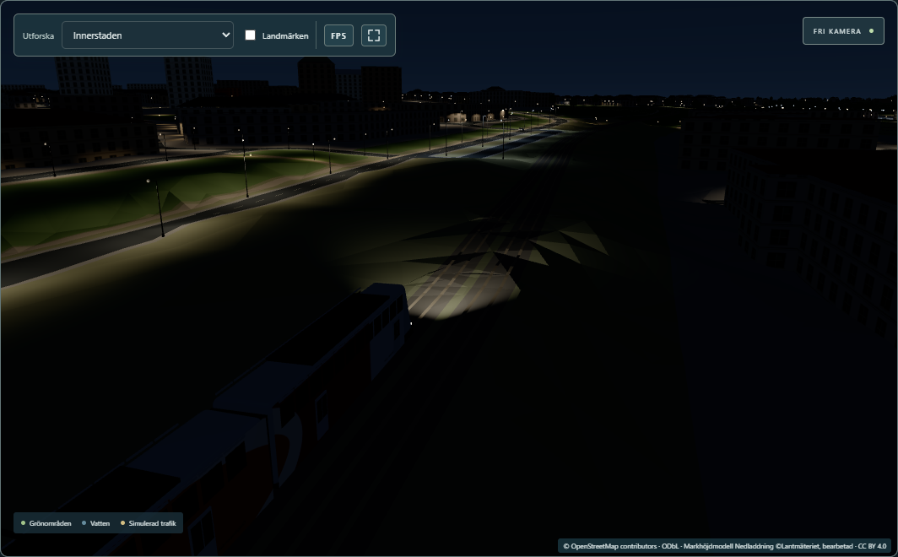 |

Day pictures 07–12 (same six viewpoints): each F2 file is **byte-identical** to `main`'s.

Brightness of the track 12 m ahead of the nose, followed vehicle, night (Playwright test, mean
screen brightness 0–255): tram 35.4 without its beam → **52.2** with it; train 2.3 → **19.1**
([data/e2e.json](data/e2e.json)). The tram stands on a lit street, the train on a dark track.

## Measured

Paired timing against `main` (`eee971c`), the same set-up as D2: hook builds, fullscreen 2560×1440,
traffic on through the backend copy 8095 (202 vehicles, 8 trams and 2 trains among them), Edge
headless, uncapped, 600 frames per view, builds in rotated order, 5 rounds; a round starts only when
background CPU is ≤ 18 % (it was 2.9–16 %). RTX 5070 Ti, Ryzen 7 9800X3D.

Each difference is to `main` in the same round, as median [min … max] in ms. *rAF* is the time
between two frames as the viewer sees it; *p95* is the time that 95 % of the frames stay under.

| View | `main` rAF mean | F2 | rAF mean | rAF p95 | Draw calls |
|---|---:|---:|---:|---:|---:|
| Centrum, night (tram lines) | 4.48 ms | 4.52 | +0.16 [−0.28 … +0.45] | +0.10 [−0.30 … +0.50] | 672 → 672 |
| Bangården, night (railway and tram stop) | 2.94 | 2.89 | −0.03 [−0.41 … +0.13] | +0.30 [−1.50 … +0.70] | 451 → 451 |
| Bangården, day | 2.36 | 2.33 | −0.01 [−0.09 … +0.15] | 0.00 [−0.10 … +0.50] | 450 → 450 |
| Overview, night | 6.56 | 6.50 | −0.02 [−0.15 … +0.17] | 0.00 [−0.10 … +0.60] | 2 024 → 2 024 |

- **Reading:** no cost that can be measured. Every difference goes both up and down between the
  rounds, and the medians are within ±0.2 ms. That is expected: nothing new is drawn (the same draw
  calls, triangles and material switches), and the shader already ran its fixed loop of 16 beams.
- No frame took over 16.7 ms in any run (the slowest single frame was 12.6 ms).
- Shader programs: 20 before and after, by day and at night, beams on and off.
- Data: [data/paired.json](data/paired.json) ([summary](data/paired-summary.md)).

## Checks

All on the final code.

| Check | Result |
|---|---|
| `npm run check` (type check) | 0 errors, 0 warnings (1 224 files) |
| `npm run build` | OK. Built twice: all 29 files of `dist/` byte-identical (SHA-256) |
| `npm test` (Vitest, PowerShell, `C:\`) | **607 / 608**. The one failure is the known `police.test.ts` "outline belongs to the current artwork" (fails on `main` too). New: `railLights.test.ts` 4 / 4 |
| Playwright, full suite, 30 tests including the new `rail-lights.spec.ts` (dev server `phase0-e2e` + backend `phase0-backend`) | **30 / 30** (7.2 min) |
| Day pictures against `main` | 6 / 6 byte-identical files |
| Earlier phases' data | `git status`: no change under `src/lib/data`, `scripts/data` or earlier `docs/**`; only the files listed below |

Not run: weaker hardware; other browsers than Edge.

New unit tests ([`railLights.test.ts`](../../src/lib/lighting/railLights.test.ts)):
- the lamp table equals the drawn lenses (front face and height read from the model geometry), white
  lenses only at the front end, red only at the rear end;
- the lamp follows the pitch, the beam stays horizontal, light falls ahead of the nose and not under
  the train;
- one pose per bus, tram and train (the leading section, with its pitch), and they take part in the
  nearest-vehicle selection;
- lens glow: unchanged by day, brighter at night, for all four lens materials.

No existing test was changed. F1's unit test "trams and trains excluded" concerns the car models
(`transportModels.ts`), which still do not draw trams or trains, and passes as it was.

New Playwright test ([`rail-lights.spec.ts`](../../tests/rail-lights.spec.ts)): 10 cars, 4 trams and
2 trains, paused, at night. For a followed tram and a followed train: it has a full-strength beam,
the track 12 m ahead is brighter with the beam than without, switching the beams creates no shader
program; by day there are 0 beams.

## Files

- **New:**
  - `src/lib/lighting/railLights.test.ts`, `tests/rail-lights.spec.ts`
  - `scripts/rail-lights-f2/{shots,paired,summarize}.mjs` (the last two copied from D2's)
  - `docs/rail-lights-f2/**`
- **Changed:**
  - `src/lib/lighting/vehicleLights.ts` (two kinds in the lamp table, optional pitch)
  - `src/lib/publicTransport.ts` (poses of trams and trains, lens glow)
  - `.gitignore`: `/work/rail-lights-f2/`
  - `docs/board/board.json`, `docs/roadmap.md`, `docs/claude-progress.md`
- **Local only:**
  - `.claude/launch.json` (`f2-main` 5351, `f2-new` 5352, `f2-main-dev` 5353)
  - `work/rail-lights-f2/` (hook builds, raw runs, logs, screenshots). The `main` worktree used for
    the comparison was removed.

## Reproduce

```
npx vitest run src/lib/lighting/railLights.test.ts                                # PowerShell, uppercase C:\ path
E2E_BASE_URL=http://127.0.0.1:5194 npx playwright test tests/rail-lights.spec.ts  # phase0-e2e + phase0-backend
node scripts/rail-lights-f2/shots.mjs http://127.0.0.1:5194 <new-dir>             # a DEV server (needs the camera hook)
# hook builds (VITE_LIGHTING_HOOK=1) of main (worktree) and of the working tree; preview f2-main 5351, f2-new 5352
MAX_BUSY=18 node scripts/rail-lights-f2/paired.mjs <new.json> 5 main=http://127.0.0.1:5351 f2=http://127.0.0.1:5352
node scripts/rail-lights-f2/summarize.mjs <run.json> > <summary.md>
```

Do not run the `main` DEV server and the working tree's DEV server at the same time: they share
`node_modules/.vite` through the junction.

See also [data-provenance.md](data-provenance.md), [remaining-gaps.md](remaining-gaps.md) and
[rail-lights-provenance.json](rail-lights-provenance.json).
